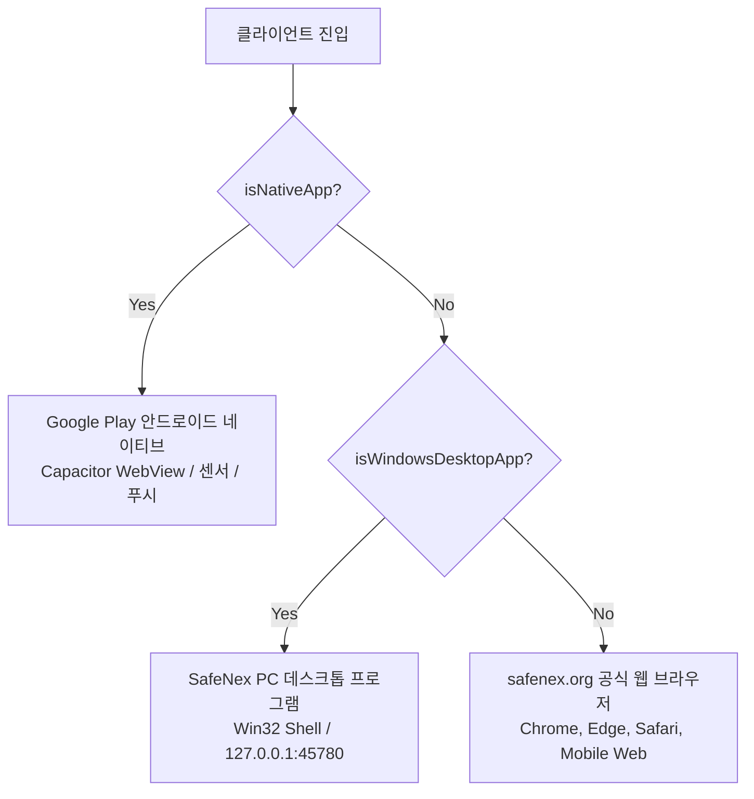

# SafeNex 멀티플랫폼(안드로이드 구글 플레이 · PC 데스크톱 · 공식 웹) 통합 운영 규칙 (SSOT)

> **핵심 원칙**: SafeNex 시스템은 **Google Play에 정식 출시된 안드로이드 네이티브 앱**, **Windows PC 메신저 및 그룹웨어 프로그램**, **공식 웹사이트(`safenex.org`)** 가 동일한 백엔드(Supabase)와 웹 코드베이스를 공유합니다. 
> 하나의 플랫폼 수정이나 배포 작업이 다른 플랫폼에 절대로 부작용이나 오작동을 유발하지 않도록 아래 규칙을 엄격히 준수합니다.

폰 OTA와 PC OTA를 목록에서 나누는 제안은 `docs/ota-platform-split-plan.md`에 있다. 그 문서의 「검토 의견」이 채워지고 합의되기 전에는, 아래 현재 규칙이 그대로 유효하다.

---

## 1. 플랫폼 판별 및 런타임 격리 원칙



### 규칙 1-1. 플랫폼 가드 필수화
| 플랫폼 | 식별 함수 | 허용 리소스 | 금지 리소스 |
|---|---|---|---|
| **안드로이드 네이티브** | `isNativeApp()` (`Capacitor.isNativePlatform()`) | `@capacitor/*`, `@capgo/*`, 하드웨어 GPS, 백그라운드 위치, FCM 푸시, 바코드 카메라 스캐너 | PC 전용 엔드포인트(`/__desktop/*`), `window.safenexDesktop`, Win32 API |
| **PC 데스크톱** | `isWindowsDesktopApp()` (`safenexDesktop.isDesktopApp`) | C# 로컬 서버(`127.0.0.1:45780`), 창 크기 제어(`/__desktop/resize`), 트레이 알림, 로컬 `www` 교체 | Capacitor 네이티브 전용 플러그인 (가드 없이 호출 금지), 모바일 전용 바텀 네비게이션 |
| **공식 웹 (`safenex.org`)** | 둘 다 `false` | 표준 브라우저 API, PWA 설치 프롬프트 | 네이티브 전용 플러그인 직접 호출, 로컬 포트 45780 전제 기능 |

---

## 2. 버전 관리 및 SSOT 원칙 (Versioning Rules)

### 규칙 2-1. `package.json`이 유일한 단일 진실 공급원 (SSOT)
- 모든 시맨틱 버전(SemVer, 예: `1.1.5`)의 기준은 `package.json`의 `"version"` 필드입니다.
- **절대 금지**: `package.json`을 올리지 않고 C# 코드(`SafeNexWindowsSetup.cs`)나 개별 UI 화면의 버전 문자열만 단독으로 올리는 행위 금지.
  - 버전을 올릴 때는 `package.json`을 먼저 수정하고, 관련된 런처/다이얼로그의 기본값을 함께 동기화해야 합니다.

### 규칙 2-2. OTA 릴리스 명명 규칙
- GitHub Actions CI(`mobile-release.yml`)가 `main` 브랜치 push 시 자동 생성하는 OTA 릴리스는 다음 형식을 갖습니다:
  $$\text{Version} = \text{<package.json.version>} - \text{<YYYYMMDDHHMM>}$$
  *(예: `1.1.5-202611050247`)*
- 안드로이드(`otaUpdater.ts`)와 PC(`desktopBridge.ts`)의 버전 비교기는 모두 이 형식의 타임스탬프 빌드를 최신 빌드로 올바르게 인식해야 합니다.

---

## 3. 구글 플레이 스토어 안전 보장 규칙 (Google Play Store Safety)

### 규칙 3-1. `min_native_version` (Play 스토어 강제 업데이트 기준) 보존
- `app_releases` 테이블의 `min_native_version`은 **Google Play에 업로드된 안드로이드 바이너리의 `versionCode` 정수**(예: `478`)입니다.
- **치명적 위험 방지**:
  - PC 업데이트나 웹 배포 시 이 값을 `null`로 지우거나, 임의의 문자열(예: `1.1.5`)로 덮어쓰면 **구글 플레이 정상 사용자들에게 스토어 업데이트 차단 화면(NativeStoreUpdateGate)이 오작동하거나 구버전 차단이 해제**됩니다.
  - `publish-ota-release` Edge Function은 신규 OTA 업로드 시 직전 릴리스의 `min_native_version`을 자동으로 유지·계승합니다.
  - 네이티브 코드가 변경되어 Play 스토어 새 AAB 배포가 필요한 경우에만 관리자 메뉴(`/app/admin/settings/mobile-releases`) 또는 AAB CI를 통해 새 `versionCode`로 명시적 갱신합니다.

### 규칙 3-2. 안드로이드 AAB 빌드와 웹/PC OTA 빌드의 분리
| 구분 | 트리거 | 빌드 산출물 | 배포 대상 |
|---|---|---|---|
| **웹 & 무설치 OTA** | `main` 브랜치 push | Web 번들 (`dist/`) + OTA zip | Supabase Storage (`app-updates`), 안드로이드 앱 무설치 OTA, PC 프로그램 무설치 핫스왑, Vercel 웹 |
| **안드로이드 구글 플레이** | `android-v*` 태그 push 또는 수동 워크플로 실행 | 서명된 `.aab` + R8 `mapping.txt` + NDK `native-debug-symbols.zip` | Google Play Console (내부 테스트 / 프로덕션 트랙) |

---

## 4. PC 데스크톱 및 웹사이트 연동 규칙 (Desktop & Web Safety)

### 규칙 4-1. PC 로컬 격리
- PC 프로그램은 `%LOCALAPPDATA%\SafeNexPC\` 아래의 독립된 경로를 사용합니다:
  - `www/`: 웹 번들 정적 파일 (무설치 OTA 핫스왑 대상)
  - `UserProfile/`: Chromium 브라우저 세션 및 캐시
- 안드로이드 앱의 로컬 스토리지(`Capacitor Preferences`)와 물리적으로 분리되어 있어 상호 간섭이 없습니다.

### 규칙 4-2. 원클릭 웹사이트 로그인 이어가기 (`desktop-web-handoff`)
- PC 프로그램에서 `https://safenex.org` 공식 웹사이트로 이동할 때는 URL에 기존 세션 토큰을 직접 노출하지 않고, 전용 Edge Function(`desktop-web-handoff`)을 통해 1회용 매직링크를 생성하여 새 브라우저 탭으로 안전하게 연결합니다.

---

## 5. 배포 전 필수 검증 체크리스트

모든 변경 사항은 아래 4대 단위 테스트를 통과해야 커밋 및 배포할 수 있습니다:

1. **PC 데스크톱 브릿지 및 설정 테스트**:
   ```bash
   bun run test src/test/desktopWorkspace.test.ts
   ```
2. **안드로이드 OTA 버전 비교 로직 테스트**:
   ```bash
   bun run test src/test/otaVersionCompare.test.ts
   ```
3. **Play 스토어 `min_native_version` 보존 테스트**:
   ```bash
   bun run test src/test/otaMinNativePublish.test.ts
   ```
4. **구글 플레이 네이티브 스토어 업데이트 게이트 테스트**:
   ```bash
   bun run test src/test/nativeStoreUpdate.test.ts
   ```
