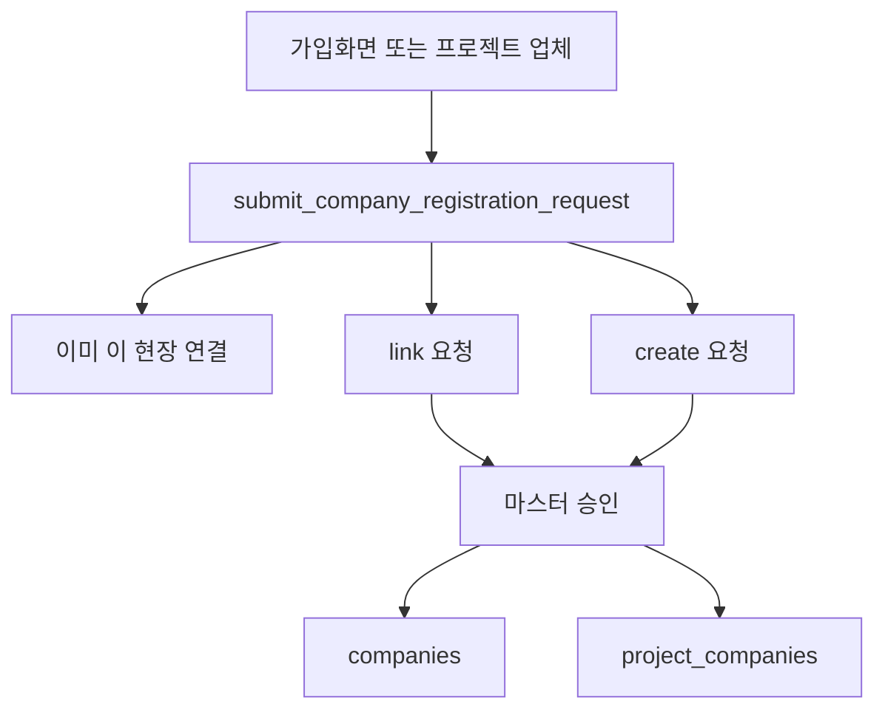

# 회사 등록·수정 화면 정리 (검토 반영)

타사 검토([docs/company-registration-screen-plan-feedback.md](docs/company-registration-screen-plan-feedback.md), 커밋 `0052795c`)의 방향과 네 가지 답은 채택한다. 가입 교착은 `src/pages/Auth.tsx`의 `handleManagerSignup`이 디렉터리에서 프로젝트·업체·직책을 모두 고르게 하고, `get_signup_company_directory`가 이미 `project_companies`에 연결된 업체만 돌려주므로 사실이다. 비로그인 테이블 INSERT를 그대로 여는 제안은 상태 위조와 대기열 노출이 있어, 제출·승인 RPC로 좁힌다.

## 채택한 결정

- 회사 상세 개요의 저장을 뺀다. 이름·사업자번호·연락처·주소는 설정 > 업체 관리의 마스터만 고친다. 상세에는 "업체 기본 정보는 설정 > 업체 관리에서 수정합니다" 안내만 둔다.
- 신규 회사 승인은 마스터만 한다. 현장 관리자는 요청만 낸다.
- `company_departments`, `company_managers`는 회사 공통으로 둔다. 로그인·결재 권한은 `project_members` 그대로다.
- 프로젝트 폼의 저장되지 않는 `scope`, `period` 글상자는 뺀다. 그 자리에 이 현장의 공사명·착공일·준공일·도급금액을 두고 `company_construction_info`에 저장한다. 회사 상세 공사 탭은 같은 행을 보여 주는 두 번째 입구다.
- 설정 저장은 이미 연결된 현장의 `role_in_project`를 덮어쓰지 않는다. 새로 연결할 때만 마스터 유형을 역할 초기값으로 넣는다.

## 그대로 두는 것

- 마스터가 설정에서 업체를 직접 만들고 병합·삭제하는 길.
- 초대코드 가입, 근로자 QR 가입. 근로자 가입은 등록 QR의 프로젝트·업체를 쓰고 회사를 만들지 않는다.
- 서류·근로자·공사 개요의 현장 분리, `companies`의 레거시 `scope` / `period` / `project_id` 컬럼.

## 등록 요청

요청은 두 입구다. 로그인한 사용자는 프로젝트 업체 화면에서, 비로그인 관리자 가입은 `Auth.tsx` 업체 선택 아래 "소속 회사가 목록에 없으신가요?"에서 같은 RPC를 호출한다.

요청 값: 회사명, 사업자번호, 유형, 연락처, 주소, `project_id`, 협력사이면 그 현장의 상위 시공사, 신청자 이름·이메일·전화, 메모. 가입 화면 요청은 현장을 반드시 고른다. 현장 목록은 이미 공개된 `get_signup_projects`를 쓴다. 상위 시공사는 그 프로젝트 디렉터리의 시공사만 고른다.

보내기 전에 기존 회사와 맞춘다. 하드 키는 `companies_norm_name_uidx`와 같다. `lower(regexp_replace(name, '\s+', '', 'g'))`, 삭제되지 않은 행. 사업자번호가 있으면 그것도 맞춘다.

- 그 현장에 이미 연결돼 있으면 요청을 만들지 않고 그 회사를 고르게 한다.
- 회사는 있으나 이 현장 연결이 없으면 `request_kind = link`. 승인 시 `project_companies`만 추가하고, 이미 있는 `companies.type`은 바꾸지 않는다. 새 연결의 `role_in_project`만 요청 유형으로 둔다.
- 없으면 `request_kind = create` 한 건. 같은 키나 같은 사업자번호의 `pending`이 있으면 새로 만들지 않고 "이미 접수됨"만 돌려준다. 다른 사람의 요청 내용은 돌려주지 않는다.
- `normalize_company_label`만 비슷한 후보는 자동 병합하지 않는다. 승인 화면에서 마스터에게 기존 회사로 연결할지 보여 준다.

테이블 `company_registration_requests`에 위 컬럼과 `status`(pending/approved/rejected), `rejection_reason`, `created_company_id`를 둔다. `anon`이 테이블에 직접 INSERT/SELECT 하지 못한다. 제출은 `submit_company_registration_request` SECURITY DEFINER만 허용하고, 함수가 `status = pending`, `requester_id = auth.uid()`(비로그인은 null)로 고정한다. 클라이언트가 넘긴 상태·생성 회사 id는 무시한다. 조회는 본인 요청(`requester_id = auth.uid()`)과 마스터만. 승인·거절 UPDATE는 마스터만.

승인 RPC `approve_company_registration_request`는 마스터만 호출한다.

- create: `companies`를 만들고, `project_id`가 있으면 `project_companies`를 역할·상위 업체와 함께 연결한다.
- link: 연결만 추가한다. 그 현장에 이미 있으면 역할을 덮어쓰지 않고 승인만 기록한다.
- 그 사이에 같은 이름·사업자번호 회사가 생겼으면 새 행을 만들지 않고 기존 회사 연결로 돌린다.
- 협력사인데 상위 시공사가 없거나, 그 상위가 해당 현장에 없으면 승인하지 않는다.
- 거절은 사유만 남기고 회사 행을 만들지 않는다.
- 승인 결과는 회사와 그 현장 연결뿐이다. 근로자, 서류, `project_members`는 생기지 않는다. 신청자는 승인 뒤 디렉터리에서 그 업체를 골라 가입한다.

## 화면

- [src/pages/SettingsCompanies.tsx](src/pages/SettingsCompanies.tsx): 역할 덮어쓰기 루프를 제거한다. 대기 요청 목록에서 승인·거절한다. 비슷한 회사 후보가 있으면 기존 회사로 연결하는 선택을 둔다.
- [src/pages/ProjectDetail.tsx](src/pages/ProjectDetail.tsx): `handleAddCompany`의 `companies.insert`와 저장되지 않는 `scope`/`period`를 뺀다. 검색에 없으면 등록 요청으로 보낸다. 연결·수정 창은 역할·상위 업체·발주처 열람과 이 현장 공사명·착공·준공·도급금액을 한 번에 저장한다. 금액·기간은 `company_construction_info`(`company_id` + `project_id`)에 넣는다.
- [src/pages/CompanyDetail.tsx](src/pages/CompanyDetail.tsx): 개요 저장 버튼과 저장 핸들러를 제거하고 설정 안내를 둔다. 공사 탭은 같은 `company_construction_info` 행을 유지한다. 조직·담당자 탭은 유지한다.
- [src/pages/Companies.tsx](src/pages/Companies.tsx): 카드에 이 현장의 착공~준공과 도급금액을 보여 준다. 시공사·협력사·공급사 중 공사정보가 없으면 "공사정보 없음"을 보여 준다. 발주처는 공사금액 대상이 아니다.
- [src/pages/SafetyAppointments.tsx](src/pages/SafetyAppointments.tsx): 이 현장 공사정보를 읽어 회사별 참고 규모와 현재 활성 선임 수를 보여 준다. 금액이 없으면 공사정보 입력으로 보낸다. 선임 행은 만들지 않는다.
- [src/pages/Auth.tsx](src/pages/Auth.tsx): 업체 조회로 가입하는 화면에 비로그인 등록 요청 모달을 둔다. 가입 제출 조건(기존 업체 선택 또는 초대코드)은 유지한다. 가입 요청에는 도급금액을 넣지 않는다. 승인되어 현장에 붙은 뒤 프로젝트 업체 창에서 입력한다.

## 사용자가 밟는 순서

화면을 더 늘리지 않는다. 현장에 업체를 다루는 일은 한 창에서 끝난다.

1. 프로젝트 업체에서 회사 이름을 검색해 고른다. 없으면 회사명·사업자번호·연락처만 적어 등록 요청을 보낸다.
2. 같은 창에서 이 현장 역할, 상위 시공사, 공사명, 착공일, 준공일, 도급금액을 저장한다. 금액을 아직 모르면 연결만 먼저 할 수 있고, 목록에 "공사정보 없음"이 남는다.
3. 회사 목록 카드에서 그 현장의 기간과 금액이 바로 보인다.
4. 안전관리자 선임 화면은 그 값을 읽어 "참고 규모 / 지금 선임된 인원"을 보여 준다. 금액이 비어 있으면 2번 창으로 보낸다.

가입 신청자는 도급금액을 모를 수 있으므로 요청 폼은 회사 기본정보만 받는다. 공사정보는 그 회사가 현장에 붙은 뒤에 현장 관리자가 넣는다.

## 공사기간·금액과 선임

맞다. 안전관리자 규모는 회사 공통 정보가 아니라 그 현장의 공사금액과 공사기간으로 본다. 같은 회사가 다른 현장에 들어가면 금액과 기간이 다르다. 저장 위치는 이미 있는 `company_construction_info`다. `company_id`와 `project_id`를 같이 가지고, 공사명·착공·준공·도급금액 칸이 있다. 회사 상세 공사 탭이 이 행을 읽고 쓴다. 프로젝트 업체 창의 `scope`/`period`는 이 테이블에 들어가지 않아 버려진다.

선임 화면 [`src/pages/SafetyAppointments.tsx`](src/pages/SafetyAppointments.tsx)는 지금 이 금액을 보지 않는다. 명부만 손으로 등록한다. 이번 변경은 명부를 자동으로 만들지 않고, 금액·기간이 있으면 참고 규모와 현재 활성 선임 수를 나란히 보여 준다. 금액이 없으면 "도급금액을 입력하면 선임 규모를 볼 수 있습니다"와 입력 버튼만 보여 준다.

참고 규모는 `src/lib`의 한 함수로 둔다. 공사금액 구간과, 기간이 있을 때의 전담 여부 참고를 반환한다. 화면 문구는 "법정 확정"이 아니라 "참고"다. 숫자는 구현 전에 산업안전보건법 시행령 별표의 건설공사 기준과 맞춘다. 어시스턴트 문구에 있는 50억~120억 표는 화면과 연결되어 있지 않으므로 그대로 베끼지 않는다.

안전관리비 화면의 `safety_cost_constructions.construction_amount`는 계상용 금액이라 이번 선임 참고의 입력이 아니다. 두 금액을 자동으로 덮어쓰지 않는다. 회사 목록의 "공사정보 미등록"은 지금 협력사·공급사만 표시한다. 시공사도 포함해, 현장 안전관리자 규모를 볼 금액이 비어 있는 것이 보이게 한다. 발주처는 제외한다.

## 이번에 넣지 않는 기능

흐름을 짧게 유지하기 위해 아래는 만들지 않는다.

- 선임 행 자동 생성, 노동청 신고 자동 작성
- 가입 요청 폼에 도급금액·공사기간 필수 입력
- 안전관리비 공사금액과 회사 공사정보의 자동 동기화
- 조직·담당자 명단의 현장별 분리
- 금액 없이 업체 연결을 막는 검증
