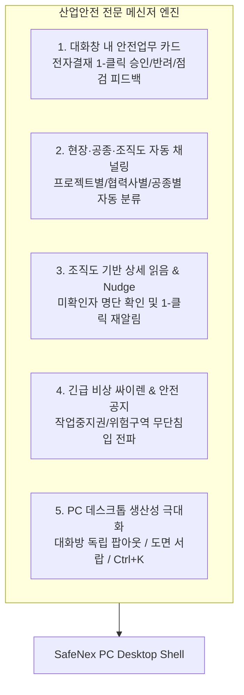

# SafeNex PC 무설치 자동 업데이트(Zero-Reinstall) 및 전문 산업안전 메신저 로드맵

> **문서 상태**: 공식 승인 및 운영 규약 (SSOT)  
> **최초 작성일**: 2026-11-06  
> **관련 문서**: `docs/MULTI_PLATFORM_OPERATING_RULES.md`, `docs/ota-platform-split-plan.md` (#625)

---

## 1. 개요 및 핵심 원칙

SafeNex PC 데스크톱 프로그램은 단순한 웹 뷰어나 사적 채팅 도구가 아닙니다.  
**중대재해를 예방하고 법정 안전업무(위험성평가, 작업허가서, 안전점검, TBM)를 실시간으로 처리하는 산업안전 전문 엔터프라이즈 메신저**입니다.

### [절대 원칙 1] 사용자 재설치 영구 금지 (Zero-Reinstall Policy)
1. **유일한 정식 런처**: **Electron 34 LTS (`electron/main.cjs`)**.
2. **구형 C# 파일 폐기**: `electron/SafeNexWindowsSetup.cs`는 영구 폐기(DEPRECATED)되었으며, 어떤 AI 에이전트나 스크립트도 본 파일을 컴파일하거나 사용자에게 별도 `.exe`를 전달해서는 안 됩니다.
3. **무설치 백그라운드 핫스왑**: 모든 화면, UI, 기능, 결재, 메신저 수정은 GitHub Actions의 OTA 배포 파이프라인(`mobile-release.yml` -> Supabase Storage -> `/__desktop/apply-ota`)을 통해 사용자가 프로그램을 사용하는 동안 백그라운드에서 다운로드되고, 프로그램 재실행 시 0초 만에 교체 적용됩니다.

---

## 2. 전문 산업안전 엔터프라이즈 메신저 5대 핵심 아키텍처

### ① 현장 안전 업무 직결형 인터랙티브 카드 (In-Chat Workflows)
- **전자결재 1-클릭 인스턴트 액션**: 대화방에 공유된 안전문서 카드에서 관리자가 대화 흐름을 벗어나지 않고 즉시 **[1-클릭 승인]**, **[반려]**, **[문서 상세 열람]** 가능.
- **승인 즉시 알림 자동 해제**: 대화창에서 승인하는 순간 `notifications` 테이블의 `approval_request`가 자동으로 읽음 처리되어 레일 뱃지 및 알림이 즉시 소멸.
- **안전점검 지적사항 조치 루프**: 현장 순찰 사진 공유 -> 지적사항 태그 -> 협력업체 조치 사진 답장 -> 자동 조치 완료 처리.

### ② 발주처-원청-협력업체 조직도 기반 자동 채널링 (Safety Channeling)
- 대화방 목록을 개인 톡방처럼 방치하지 않고 탭으로 분류:
  - **[현장 채널]**: 프로젝트별 (예: A현장 전체, B현장 안전팀)
  - **[공종·협력사]**: 공종별 (토목/철골/비계/전기) 전용 소통 채널
  - **[1:1 업무 대화]**: 조직도 기반 직원/현장소장 다이렉트 메시지
  - **[안전 알림방]**: 결재, 시스템 경보, TBM 일지 브리핑 전용

### ③ 조직도 기반 '상세 읽음 확인' 및 '미확인자 리마인드(Nudge)'
- 그룹 대화방에서 단순히 숫자 `1`이 줄어드는 것이 아니라, **[확인 완료 N명 (이름, 직책, 확인시각) / 미확인 N명]** 상세 명단 제공.
- 긴급 공지 시 미확인 작업자/소장에게 **[1-클릭 재알림(푸시/알림톡)]** 전송 기능 지원.

### ④ 긴급 비상 싸이렌 및 안전 공지 고정 배너 (Emergency SOS)
- 위험구역 무단침입, 가스누출, 악천후(강풍·폭우), 작업중지권 발동 시 대화방 상단에 **강렬한 적색/주황색 비상 경보 배너** 노출.
- 현장 전원 대피 지침 및 비상 집결지 안내 원클릭 전파.

### ⑤ PC 데스크톱 전용 생산성 (Productivity & Multi-Window)
- **대화방 독립 팝아웃(Pop-out)**: 대화방 더블 클릭 시 별도 독립 창(`openPopoutWindow`)으로 분리되어 멀티 모니터에서 여러 대화방을 동시에 띄워두고 작업.
- **안전 도면 및 사진 전용 보관함 (Drawer)**: 대화방 내 주고받은 캐드 도면(PDF), 안전점검 사진, 결재 첨부파일을 낱개로 찾지 않고 서랍 탭에서 일괄 검색 및 다운로드.
- **초고속 단축키 지원**: `Ctrl + K` (직원/채널 통합 검색), `Esc` (창 닫기), `Enter` / `Ctrl + Enter` 선택 전송.
