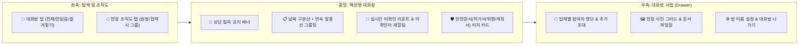

# SafeNex 엔터프라이즈 메신저 전면 개편 기획 및 아키텍처 제안서 (RFC)

> **목적**: 메신저 개편의 방향과, 검토 뒤에 코드에 넣은 제한을 같이 적는다.
> **범위**: 이 PR은 기획서와 메신저 화면, `supabase/migrations/20261104163000_messenger_enterprise_upgrade.sql` 을 함께 바꾼다. SQL은 이 파일에만 있고, 리뷰 전에 라이브 데이터베이스에는 올리지 않는다.

---

## 1. 현행 메신저(AI Studio 1차 구현본) 정밀 진단

### 1.1 기능 및 로직 결함 (Broken / Incomplete Features)
1. **말풍선 미확인 인원 카운트(`unread_count`) 미작동**
   - `src/components/messenger/MessageBubble.tsx`에서는 `message.unread_count > 0 ? message.unread_count : "읽음"`을 표시하도록 작성되어 있으나, 정작 메시지를 로드하는 `src/lib/messengerApi.ts`의 `hydrateChatMessages()`에서는 참가자별 `last_read_at` 대비 미확인 인원수를 전혀 계산하지 않음.
   - 결과적으로 상대방이 읽지 않아도 **모든 메시지가 항상 `"읽음"`으로만 표시**됨.
   - 또한 상대방이 방에 입장해 읽음 처리(`chat_participants.last_read_at` 갱신)했을 때, 내 화면의 미확인 숫자가 실시간으로 차감되는 Realtime `UPDATE` 구독이 누락됨.
2. **DB 스키마만 존재하고 프론트엔드/RPC에 연결되지 않은 미완성 기능**
   - `chat_rooms.pinned_message_id` (상단 공지 고정): 컬럼만 존재하며 공지 등록·해제 UI 및 상단 배너가 없음.
   - `chat_reactions` (이모지 리액션): 테이블과 RLS 정책만 존재하며 UI 및 API 호출부가 전혀 없음.
   - `chat_room_messages.is_deleted` (메시지 삭제/회수): 본인 메시지 취소/삭제 UI 및 RPC가 없음.
   - `chat_participants.room_name_override` / `left_at`: 방 이름 커스텀 변경 및 대화방 나가기 UI가 없음.
3. **대화방 목록 조회 N+1 쿼리 구조**
   - `fetchMyChatRooms()`에서 참여 중인 방 목록을 가져온 뒤, 방 개수만큼 `Promise.all`로 `chat_room_messages` `count(*)` 쿼리를 개별 호출함 (방 20개 = 20회 왕복).
   - 어떤 방이든 새 메시지가 1건 들어올 때마다 전체 방 목록을 처음부터 재조회함.

### 1.2 UI / UX 및 운영상의 한계
1. **기본 채팅 타임라인 가독성 부족**
   - 날짜 변경 구분선(`2026년 11월 4일 수요일`)이 없어 어제 대화와 오늘 대화가 구분되지 않음.
   - 동일 발신자가 1분 내에 연속으로 여러 메시지를 보내도 매 줄마다 프로필 아바타·이름·회사·직책·시간이 반복 출력되어 화면이 산만함.
2. **대화방 관리 서랍(Room Drawer) 부재**
   - 대화방 안에서 **현재 참여자 명단(원청/협력사 소속 구분)**을 볼 수 없음.
   - 기존 방에 **새로운 관리자 추가 초대**, **대화방 나가기**, **주고받은 현장 사진·문서 모아보기**가 불가능함.
3. **입력 및 탐색 편의성 부족**
   - PC에서 캡처 이미지 붙여넣기(`Ctrl+V`), 파일 드래그 앤 드롭 업로드 미지원.
   - 대화방 내 과거 메시지 키워드 검색 기능 부재.

---

## 2. 타사 엔터프라이즈 및 건설현장 메신저 벤치마킹

| 벤치마크 서비스 | 핵심 강점 | SafeNex 메신저 도입 포인트 |
| :--- | :--- | :--- |
| **네이버웍스 (LINE WORKS)** | • 메시지별 읽은 사람 / 안 읽은 사람 명단 분리 • **안 읽은 사람에게만 재알림(콕 찌르기)** 발송 • 방 상단 필독 공지 접기/펴기 배너 및 사진·파일 서랍 | • `ReadReceiptModal`에 **[미확인자 일괄 재알림 푸시]** 기능 도입 • 대화방 상단 고정 공지 배너 및 우측 정보 서랍(사진·파일함) 신설 |
| **카카오워크 / 카카오톡** | • **[대화방 | 조직도]** 분리 및 업체·부서별 트리 탐색 • 실시간으로 차감되는 노란색 미확인 숫자(`3` → `1` → 사라짐) • 연속 말풍선 그룹핑 및 날짜 구분선 | • 좌측 패널을 **[💬 대화방 | 🏢 현장 조직도]** 2탭 구조로 개편 • `chat_participants` Realtime 연동으로 실시간 읽음 숫자 차감 구현 |
| **슬랙 (Slack) / 두레이** | • 목적별 공식 채널 운영 및 빠른 상태 리액션(`✅`, `👀`, `🚨`) • 즐겨찾기(Starred) 채널 상단 고정 | • 현장용 원클릭 스탬프 리액션(`✅ 확인`, `👍 완료`, `👀 검토중`, `🚨 주의`) • 중요 대화방 즐겨찾기(`⭐`) 상단 고정 및 `안읽음` 필터 탭 |
| **Fieldwire / 아키엠 (건설 특화)** | • 일반 잡담이 아닌 **허가서·점검표·위험성평가·도면과 대화가 직결** • 현장 안전 문서를 채팅방에 카드로 공유하고 즉시 열람·결재 | • 입력창에 **[+ 안전문서 공유]** 탑재 (작업허가서·위험성평가·작업계획서 리치 카드 전송 및 원클릭 문서 열기) |

---

## 3. SafeNex 메신저 전면 개편 설계안

### 3.1 운영 방식 개편: "단순 채팅" → "현장 안전 지휘·협업 허브"

1. **소속 업체(원청 vs 협력사) 중심 조직도 연동**
   - 현장 관리자들은 이름보다 **"어느 업체(전기/설비/철근콘크리트)의 누구(안전관리자/현장소장/관리감독자)"**인지로 소통 대상을 찾음.
   - 좌측 패널의 **[🏢 현장 조직도]** 탭과 **[새 대화방 시작]** 모달에서 참가자를 **소속 회사별 그룹(원청 우선, 협력사 가나다순)**으로 묶어 보여주고, **[1:1 대화]** 또는 **[업체 단체방 개설]**을 원클릭으로 지원.
2. **SafeNex 안전문서 카드 공유 (Actionable Safety Cards)**
   - 채팅 입력창 좌측에 **[+ 안전문서 공유]** 버튼을 배치하여 현재 현장의 **작업허가서(`work_permits`)**, **위험성평가(`assessment_runs`)**, **작업계획서(`work_plans`)**를 검색·첨부.
   - 말풍선 내에 문서 종류 배지, 상태(승인대기/승인완료 등), 작업 위치/기간, **[안전문서 바로 열기 ↗]** 버튼이 있는 인터랙티브 카드로 렌더링.
3. **미확인자 재알림 (Unreader Reminder Push)**
   - 중요 안전 지시나 작업중지/점검 요청 후 아직 읽지 않은 관리자가 있을 때, 읽음 확인 모달(`ReadReceiptModal`)의 **[안 읽은 사람]** 탭에서 **[미확인자 재알림]** 버튼을 누르면 미확인자(`last_read_at < message.created_at`)에게만 즉시 푸시 알림(`notifications` 테이블 경유)을 재발송.

---

### 3.2 화면별 상세 UI / UX 개편 명세

#### A. 좌측 패널 (`MessengerRoomList.tsx` & `NewChatDialog.tsx`)
- **상단 2탭 전환**: `💬 대화방` (미확인 방 개수 배지 표시) | `🏢 현장 조직도`
- **세부 필터 칩**: `전체` / `안읽음` / `즐겨찾기⭐` / `1:1` / `그룹`
- **대화방 카드**:
  - 호버/클릭으로 설정 가능한 **즐겨찾기(`⭐`) 상단 고정**
  - 알림 꺼짐(`BellOff`) 아이콘, 고정 공지 보유(`Megaphone`) 아이콘 표시
  - 상대방 소속 업체 및 직책 메타데이터 노출

#### B. 중앙 대화창 (`MessengerChatPane.tsx` & `MessageBubble.tsx`)
- **상단 헤더**:
  - 방 제목 + 참여 인원수 + 참여 업체 요약(`세이프넥스건설 외 2개 업체`)
  - 우측 액션 버튼: **[🔍 대화 내용 검색]**, **[🔔 알림 켜기/끄기]**, **[📑 대화방 서랍 열기]**
- **상단 고정 공지 배너**:
  - `pinned_message_id`가 존재할 때 헤더 하단에 표시, 클릭 시 해당 메시지로 스크롤 점프 및 하이라이트
- **타임라인 및 말풍선**:
  - 날짜 변경 시 중앙 날짜 구분선(`2026년 11월 4일 수요일`) 자동 삽입
  - 동일 발신자·동일 분(minute) 연속 메시지 묶음 처리 (첫 메시지에만 아바타·이름·업체·직책 표시, 마지막 메시지에만 시각 표시)
  - 호버(PC)/탭(모바일) 툴바: 빠른 현장 스탬프 리액션(`✅ 확인`, `👍 완료`, `👀 검토중`, `🚨 주의`) + 인용 답장 + 상단 공지 고정 + 텍스트 복사 + 본인 메시지 삭제
  - 실시간 미확인 숫자 계산(`computeMessageUnreadCount`) 및 `chat_participants` Realtime `UPDATE` 반영
- **입력창**:
  - 클립보드 이미지 붙여넣기(`Ctrl+V`) 및 채팅창 전체 드래그 앤 드롭 파일 첨부 지원
  - 첨부파일 + 안전문서 카드 공유 버튼 배치

#### C. 우측 슬라이드 서랍 (`MessengerRoomDrawer.tsx` — 신규)
- **참여자 탭**: 소속 업체별 그룹핑 명단 + **[+ 대화상대 초대]** (기존 방에 신규 인원 추가 초대)
- **사진·파일 탭**: 이 방에서 공유된 **현장 사진 3열 썸네일 그리드** 및 **문서/첨부파일 다운로드 리스트**
- **방 설정 탭**: 내 화면 전용 방 이름 변경(`room_name_override`) / 그룹 공용 방 이름 변경(`chat_rooms.name`), **[이 대화방 나가기]**

---

### 3.3 백엔드(Supabase RPC & Realtime) 추가 요구사항

기존 테이블(`chat_rooms`, `chat_participants`, `chat_room_messages`, `chat_attachments`, `chat_reactions`) 스키마를 그대로 활용하면서 아래 보안 RPC(`SECURITY DEFINER`, `can_use_messenger` 및 `is_chat_room_participant` 검증 포함)를 추가한다:

1. `invite_chat_participants(p_room_id uuid, p_user_ids uuid[])`: 기존 대화방에 신규 참여자 초대 및 시스템 메시지 기록. 초대한 사람과 초대받는 사람 모두 `can_use_messenger` 여야 하고, 방의 현장 소속이 아니면 넣지 않는다. 새 방 생성(`create_chat_room`)과 같은 현장 확인이다. 근로자 계정은 여기서 빠진다.
2. `leave_chat_room(p_room_id uuid)`: `left_at = NOW()` 처리 및 퇴장 시스템 메시지 기록
3. `set_chat_room_name(p_room_id uuid, p_name text, p_for_everyone boolean)`: 내 화면 이름은 참여자 누구나. 전원에게 보이는 이름은 방 만든 사람, 마스터, 또는 그 현장의 관리자·안전관리자·현장소장만.
4. `set_chat_pinned_message(p_room_id uuid, p_message_id uuid)`: 공지 고정과 해제도 같은 사람만.
5. `delete_my_chat_message(p_message_id uuid)`: 본인 발송 메시지 소프트 삭제(`is_deleted = true`)
6. `remind_unread_chat_participants(p_message_id uuid)`: 한 번도 안 연 사람(`last_read_at` 없음)을 포함하고, 작성자 본인과 알림을 끈 사람은 뺀다. 같은 사람이 같은 메시지를 10분에 한 번만 다시 알릴 수 있다. 푸시 본문은 `확인하지 않은 메시지가 있습니다.` 로 고정하고 메시지 원문은 넣지 않는다. 반환 `-1` 은 아직 10분이 안 됐다는 뜻이다.
7. `count_my_chat_unreads(p_room_ids uuid[])`: 방 목록의 미확인 수를 한 번에 센다. 함수가 아직 없으면 화면은 예전처럼 방마다 센다.
8. `supabase_realtime` Publication에 `chat_reactions`, `chat_rooms` 추가
9. 안전문서 카드의 열기 주소는 메시지에 적힌 url을 쓰지 않는다. 종류와 문서 id로 `/app/admin/work-permits|assessment-run|work-plan/{uuid}` 만 만든다.

---

## 4. Google Play 스토어 앱(`org.safenex.app`) 및 모바일 OTA 배포 전략

현재 SafeNex는 Google Play에 출시된 Android 네이티브 앱(`org.safenex.app`, Capacitor 8 기반)과 웹 환경을 동시에 운영 중이므로, 메신저 개편 및 향후 기능 업데이트 시 아래 **2-Track 모바일 배포 체계**를 함께 적용한다.

### 4.1 OTA 자동 배포 vs Google Play 스토어(AAB) 재빌드 기준

| 구분 | 배포 파이프라인 | 적용 대상 변경 사항 | 메신저 개편 해당 여부 |
| :--- | :--- | :--- | :--- |
| **Track 1: 무선 OTA** | `.github/workflows/mobile-release.yml` (`main` 머지 시 번들을 올린다. 로그인 화면에서는 받지 않는다. 앱 안(`/app`)에 들어온 뒤에 내려받고, 앱을 내린 뒤에 적용한다.) | • React/TypeScript UI 컴포넌트 개편 • Supabase RPC / Realtime 연동 로직 • 라우팅 및 스타일(Tailwind) 변경 | ✅ **스토어 심사 없이 배포 가능** (폰이 로그인 화면에 있는 동안에는 적용되지 않는다. 이 PR을 main에 넣으면 화면이 바뀐 업데이트가 나간다.) |
| **Track 2: Google Play AAB 빌드** | `.github/workflows/android-aab.yml` (`build/android-aab` 브랜치 푸시 또는 `android-v*` 태그 푸시 → 서명된 `.aab` + R8/NDK 심볼 생성) | • Capacitor 네이티브 플러그인 추가/버전 변경 • `AndroidManifest.xml` 권한 변경 • FCM 알림 채널/사운드(`siren.wav`) 또는 네이티브 백그라운드 서비스 변경 • Play 스토어 신규 설치자용 베이스 번들 최신화 | 🔄 **주기적 베이스 번들 갱신 시 함께 생성** (네이티브 권한 추가가 없을 때는 OTA만으로 즉시 도달하며, 스토어 버전 갱신이 필요할 때 `build/android-aab`로 AAB 패키지 동시 생성) |

### 4.2 모바일(Android/iOS) 쉘 및 푸시 딥링크 설계 고려사항
1. **모바일 전용 라우트(`/app/worker/messenger`) 및 리다이렉트 보호**
   - 스마트폰 앱에서는 `/app/admin/messenger` 진입 시 `MobileRedirectGuard`와 `notificationRoutes.ts`(`toMobileShellPath`)가 `/app/worker/messenger?room=<id>`로 매핑함.
   - 안전문서 카드는 종류와 문서 id로 만든 `/app/admin/...` 주소만 `canonicalizeAppPath`에 넘긴다. 휴대폰에서는 기존 규칙대로 `/app/worker/...` 로 열린다. 메시지 본문에 적힌 주소는 열지 않는다.
2. **모바일 뷰포트 · 가상 키보드 · Safe Area 대응**
   - Android Edge-to-Edge(`SystemBars` CSS 변수 `--sat`, `--sab`) 및 `window.visualViewport` 기반 소프트 키보드 높이 보정을 유지.
   - 신규 추가되는 **우측 대화방 서랍(`MessengerRoomDrawer`)**은 데스크톱에서는 우측 슬라이드 패널(`w-80`)로, 모바일 앱에서는 전체화면 오버레이(`w-full`)로 동작하고 Android 하드웨어 뒤로가기(`NativeAndroidBack`)와 충돌하지 않도록 구성.
3. **FCM 푸시 알림(`chat_message`) 연동**
   - `notify_chat_message()` 및 신규 `remind_unread_chat_participants()`가 `notifications` 테이블에 행을 추가하면 기존 푸시 파이프라인(`dispatch-notification-push` / `send-push`)을 통해 Google Play 앱(FCM)과 웹 푸시로 동시 발송됨.

---

## 5. 다른 AI 및 리뷰어 검토 요청 사항 (Discussion Points)

1. **현장 기본 채널 자동 생성 여부**: 프로젝트(현장) 생성 또는 관리자 승인 시 `#현장전체공지`, `#원청-안전관리단` 같은 기본 공식 대화방을 자동 생성·편입시킬지, 아니면 현재처럼 수동 개설 방식을 유지할지?
2. **안전문서 공유 범위**: 1차로 `작업허가서`, `위험성평가`, `작업계획서` 3종을 지원하는데, `TBM 일지`나 `안전점검(시정조치 요청)`까지 바로 포함할지?
3. **권한 정책 유지 확인**: 현행 정책(`can_use_messenger`)상 순수 근로자(`worker`)는 메신저 대상에서 제외되고 관리자/감독자/열람자 전용으로 운영 중인데, 이 스코프를 그대로 유지할지?
4. **모바일 배포 방식 선택**: 메신저 개편 머지 시 OTA(`mobile-release.yml`) 배포만 먼저 수행할지, 아니면 Google Play 콘솔 업로드용 신규 버전 AAB(`android-aab.yml`, `build/android-aab`)까지 함께 빌드할지?
