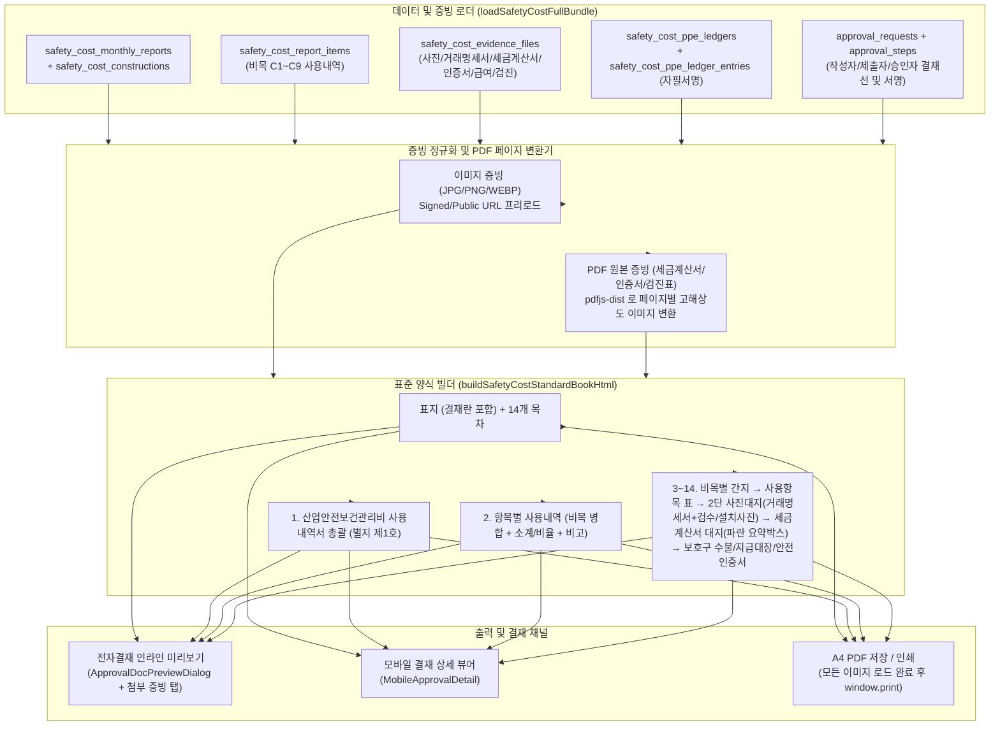

# [RFC] 산업안전보건관리비 사용내역서 결재 미리보기 · PDF 저장 · 인쇄 양식 및 증빙 편철 전면 개편 설계안

> **문서 목적**: 본 문서는 공개 자료실의 **`안전관리비 증빙 예시` (`(GSC 여수 H2,LCO2 PJT) 기계설치, 배관 및 철골공사_산업안전보건관리비사용내역서(7,8월).pdf` 및 원본 `.xlsx`)** 를 전수 분석하여, 현재 시스템에서 **① 전자결재 상신/결재 시 첨부 증빙이 보이지 않는 문제**와 **② PDF 저장/인쇄 시 거래명세서·세금계산서·현장 사진대지·인증서·지급대장이 누락되는 문제**를 해결하고, 예시 파일과 **100% 동일한 양식 구성 및 편철 순서**로 출력·미리보기 되도록 구성하기 위한 아키텍처 및 상세 설계 제안서입니다.
>
> *(주의: 사용자 요청에 따라 코드 수정 및 머지 없이 설계안만 먼저 PR로 제출합니다.)*

---

## 1. 현행 시스템의 문제점 및 원인 진단 (Root Cause Analysis)

### 1.1 전자결재(결재함/모바일 결재)에서 안전관리비 내역 및 첨부 증빙이 안 보이는 원인
1. **인라인 미리보기 대상에서 `safety_cost` 제외 (`src/lib/approvalInboxPreview.ts` L72-80)**
   - `canInlineApprovalPreview(entityType)` 함수가 `"assessment_run"`, `"assessment_run_feedback"`, `"work_plan"`, `"work_permit"`, `"safety_inspection"` 5개 유형만 허용하고 **`"safety_cost"`를 제외**하고 있습니다.
   - 이 때문에 결재자(소장/안전차장 등)가 전자결재 목록(`src/pages/Approvals.tsx`)에서 안전관리비 결재 건의 **[미리보기]** 버튼을 누르면 `ApprovalDocPreviewDialog.tsx`에서 *"이 유형은 미리보기를 지원하지 않습니다. 전체 화면에서 열어 주세요."* 라는 안내만 표시됩니다.
2. **전체 화면 이동 시 딥링크(`reportId`) 누락 (`src/lib/approvalInboxPreview.ts` L82-98, `src/pages/SafetyCost.tsx`)**
   - `getApprovalEntityPath("safety_cost", entityId)`가 `/safety-cost?from=approvals` 만 반환하고 `reportId=${entityId}` 파라미터를 전달하지 않으며, `SafetyCost.tsx`에서도 URL 쿼리(`reportId`)를 읽어 해당 공사(`selectedConstructionId`)와 해당 월 보고서(`selectedReportId`)를 자동 선택하는 로직이 없습니다.
3. **모바일 결재 상세(`src/pages/MobileApprovalDetail.tsx`) 미리보기 부재**
   - 모바일 결재 상세 화면에는 `work_permit`(작업허가서)만 전용 프리뷰 카드가 구현되어 있고, `safety_cost`는 총괄 금액, 항목별 내역, 첨부 증빙(사진/거래명세서/세금계산서)을 확인할 수 있는 UI가 전혀 없습니다.

### 1.2 PDF 저장 / 인쇄 시 증빙 사진·거래명세서·세금계산서가 안 나오는 원인
1. **`exportPDF()`가 2페이지 분량의 텍스트 요약표만 생성함 (`src/pages/SafetyCost.tsx` L964-989)**
   - 현재 `exportPDF()`는 아래와 같이 단순 텍스트 테이블 2페이지만 렌더링합니다:
     - **Page 1**: 기본 메타 테이블(대표자·소재지·발주처·공사기간·공정율 빈칸) + `1. 산업안전보건관리비 사용내역서 총괄`
     - **Page 2**: `2. 항목별 사용내역` 테이블 + 텍스트 체크리스트(`비목별 필수 증빙: 완료 N / 전체 M`, `보호구 지급대장: 서명 N/M건`)
   - 즉, `safety_cost_evidence_files` 테이블에 업로드된 **현장/검수 사진(`site_photo`), 거래명세서(`transaction`), 세금계산서(`tax_invoice`), 영수증/카드전표(`receipt`), 안전인증서(`certificate`), 급여명세서(`payroll`), 교육이수증(`education_log`)** 실제 이미지·PDF 파일과 `safety_cost_ppe_ledger_entries`의 **실제 근로자 자필 서명(`signature_data`)** 을 출력 HTML에 아예 포함하지 않고 있습니다.
2. **이미지/PDF 로딩 대기 없이 300ms 후 즉시 `window.print()` 호출 (`SafetyCost.tsx` L985)**
   - `<script>window.onload=()=>setTimeout(()=>window.print(),300)</script>` 방식으로 인쇄 창을 띄우기 때문에, 고해상도 증빙 이미지나 서명 이미지가 로드되기 전에 빈 화면으로 인쇄/PDF 저장이 실행될 위험이 있습니다.
3. **PDF 원본 증빙 파일(`application/pdf`)의 인쇄 렌더링 미지원**
   - 세금계산서, 안전인증서(KCs/CE), 건강진단 결과표, 자격증/선임보고서 등은 이미지(`jpg/png`)뿐만 아니라 **PDF 파일(`application/pdf`)** 로도 첨부됩니다. 브라우저 인쇄 시 ``나 `<iframe>` 내부의 PDF는 인쇄 페이지에 정상 출력되지 않으므로, `pdfjs-dist`를 사용해 A4 고해상도 캔버스/이미지로 변환(Rasterize)하여 인쇄 페이지에 삽입해야 합니다.

---

## 2. 공개 자료실 「안전관리비 증빙 예시」 정밀 분석 결과

공개 자료실(`project_library_files` ID: `c44e1480-90b4-44e4-9182-426861ddad8b`)에 등록된 **`(GSC 여수 H2,LCO2 PJT) 기계설치, 배관 및 철골공사_산업안전보건관리비사용내역서(7,8월).pdf` (총 239페이지)** 및 원본 엑셀(`sample_gsc_7_8.xlsx`)을 전수 분석한 결과, 실제 현장에서 발주처/감리단/고용노동부 감독관에게 제출·승인받는 **표준 양식 구조**는 다음과 같습니다.

### 2.1 전체 문서 편철 순서 (Standard 14-Section Binding Order)

| 순서 | 섹션 번호 및 명칭 | 예시 PDF 페이지 | 양식 형태 및 핵심 구성 요소 |
| :--- | :--- | :---: | :--- |
| **표지** | **`YY년 MM월 안전관리비사용내역서` 표지** | p.9 | • 상단 중앙: `26년 08월 안 전 관 리 비 사 용 내 역 서`<br>• 중단: `공 사 명 : [GSC 여수 H2/LCO2 PJT] 기계설치, 배관 및 철골공사`<br>• 하단: 시공사 로고/상호(`청원산기(주)`) + **3단 결재란 박스 (`안전관리자` \| `안전보건관리책임자` \| `발주처/감리(AIRLIQUIDE)`)** 및 서명 이미지 |
| **목차** | **`목 차` (1~14번 편철 목차)** | p.10 | • 사각 테두리 박스 안에 `1. 산업안전관리비사용내역 총괄` ~ `14. 위험성평가 등에 따른 소요비용` 14개 표준 목차 번호 고정 표기 |
| **1** | **`1. 산업안전보건관리비 사용내역서 총괄` (별지 제1호 서식)** | p.11<br>(`1.총괄` 시트) | • **1) 일반사항 (2열×7행 테이블)**:<br>  - 건설업체명 / 대표자<br>  - 소재지 (전체 병합)<br>  - 공사명 (전체 병합)<br>  - 발주처 / 공사기간<br>  - 계약금액 / 공정율(%)<br>  - 계상된 안전관리비 / 공사진척에 따른 사용기준금액<br>  - 잔여금액 / 누계집행율(%)<br>• **2) 사용내역 (5열×10행 테이블)**:<br>  - 컬럼: `항 목` \| `전월` \| `금월` \| `누계` \| `기준비율(%)`<br>  - 첫 행 `계`(하늘색 음영 강조) + `1. 안전·보건관리자 임금 등` ~ `9. 위험성평가 등에 따른 소요비용`<br>• **하단 법정 문구·일자·서명란**:<br>  - `「건설업 산업안전보건관리비 계상 및 사용기준」 제10조제1항에 따라 위와 같이 사용내역서를 작성하였습니다.`<br>  - `YYYY 년 MM 월 DD 일`<br>  - `작성자 : [업체명] 직책 : [안전과장] 성명 : [성명] (서명 또는 인)`<br>  - `제출자 : [업체명] 직책 : [현장소장] 성명 : [성명] (서명 또는 인)`<br>  - `승인자 : [발주처] 직책 : [안전차장] 성명 : [성명] (서명 또는 인)` |
| **2** | **`2. 항목별 사용내역` (전체 비목 통합 명세)** | p.12~14<br>(`2. 항목별` 시트) | • **9열 테이블**:<br>  - 1단 헤더: `구분` \| `No.` \| `월,일` \| `사 용 항 목` \| `산 출 근 거` (4열 병합) \| `비율(%)` (실무에서는 행별로 거래처명 `홍익`, `금호`, `카드`, `협회` 등을 표기하고, 소계 행에만 해당 비목의 금액 비중 `%`를 표기!)<br>  - 2단 헤더(`산출근거` 하위): `수량` \| `단위` \| `단가` \| `금액`<br>• 비목 `1) 안전·보건관리자 임금 등` ~ `9) 위험성평가 등에 따른 소요비용` 순으로 좌측 `구분` 셀을 세로 병합(`rowspan`)하고, 각 비목 마지막 줄에 회색 음영 **`소 계`** 행(금액 합계 + 전체 대비 비율 `%`) 표시<br>• 맨 마지막 줄에 **`총 계`** (총 금액 + `100%`) 표시 |
| **3** | **`3. 안전·보건관리자 임금 등`** | p.15~22 | • **간지(구분 표지, p.15)**: 중앙 `3. 안전·보건관리자 임금 등`<br>• **비목 사용항목 집계표(p.16)**: 상단 `사 용 항 목 ('YY 년 MM 월)` / `3. 안전·보건관리자 임금 등`<br>  - 전용 6열 테이블: `구분` \| `소속` \| `성명` \| `지급일` \| `지급금액` \| `비고`<br>  - 하단 고정 요약: `계` \| `전월까지 누계` \| `금월` \| `누계`<br>• **증빙 서류(p.17~22)**: `1. 자격증 사본` → `2. 근로계약서` → `3. 재직증명서` → `4. 급여명세서 + 은행 이체확인증` → `5. 선임 보고서(노동포털 별지 제3호서식)` |
| **4** | **`4. 안전시설비 등`** | p.23~53 | • **간지(p.23)**: `4. 안전시설비 등`<br>• **비목 사용항목 집계표(p.24)**: `구분(품목명) \| 수량 \| 단위 \| 단가 \| 사용금액 \| 비고(거래처)` + 하단 `계 (전월까지 누계 / 금월 / 누계)`<br>• **품목별 사진대지 (1품목 = 1페이지 2단 구성, p.25~50)**:<br>  - **상단 사진대지**: `거래명세서(해당 품목 행에 빨간 박스 강조)` + `자재 반입/검수 사진` (나란히 배치), 하단 메타 표: `날짜 \| YYYY년 M월 D일 \| 내용 \| 거래명세표/검수` / `품목 \| [품목명] \| 수량/규격 \| [수량] [단위]`<br>  - **하단 사진대지**: `현장 안전시설물 설치 사진` + `설치 위치도면(필요시)` (나란히 배치), 하단 메타 표: `날짜 \| YYYY년 M월 D일 \| 내용 \| 안전시설물 설치(/위치도면)` / `품목 \| [품목명] \| 수량/규격 \| [수량] [단위]`<br>• **업체별 세금계산서 대지 (비목 말미 일괄 편철, p.51~53)**:<br>  - 상단 타이틀 `사 진 대 지`<br>  - 중앙: `전자세금계산서` 이미지 + 좌측 하단 **파란색 요약 콜아웃 박스**:<br>    `세금계산서 총 액 11,224,800원 중 / 안전 시설비 등 사용 금액 / 6,222,500원`<br>  - 하단 메타 표(1행 4칸): `업체 \| 주식회사 홍익 \| 내용 \| 세금계산서(7월)` |
| **5** | **`5. 보호구 등`** | p.54~86 | • **간지(p.54)** → **비목 사용항목 집계표(p.55~56)** → **품목별 사진대지(p.57~83: 상단 `거래명세표`, 하단 `보호구 검수`)** → **업체별 세금계산서 대지(p.84~86: 파란색 박스 `세금계산서 총액 OOO원 중 보호구 등 사용 금액 OOO원`)** |
| **6** | **`6. 개인보호구 사용 현황` (월간 수불 집계표)** | p.87~89 | • **간지(p.87)** → **가로(Landscape) 표**: `MM월간 보호구 총괄 집계표`<br>  - 좌측: `순번 \| 품명(안전모, 안전화, 안전벨트...) \| 입·출·잔고 (3행씩)`<br>  - 중앙: `전월기준 \| 1일 ~ 31일` 일자별 입고/출고/잔고 수량<br>  - 우측: `소계` |
| **7** | **`7. 개인보호구 지급대장`** | p.90~95 | • **간지(p.90)** → **`개인보호구(안전장구) 지급대장`**<br>  - 상단: `□ 현장명 : ...` `□ 업체 : ...`<br>  - 서약 문구: `□ 본인은 금일 수령한 개인보호구(안전장구)를 작업장에서 항시 올바르게 착용하고 작업에 임하며 아래와 같이 지급받았음을 자필로 서명 합니다.`<br>  - 테이블: `구분(1~18) \| 지급일 \| 직종 \| 성명 \| 보호장구 지급내역(해당란 자필 정자 서명: 품목별 컬럼 또는 품목/수량/자필서명 이미지)` |
| **8** | **`8. 안전인증서`** | p.96~140 | • **간지(p.96)** → 반입된 보호구·안전시설물의 **KCs 안전인증서, 자율안전확인신고증명서, CE/EU-Type 시험성적서, FITI 시험성적서** 원본(PDF/이미지) 전체 페이지 편철 |
| **9** | **`9. 안전보건진단비 등`** | p.141~144 | • **간지(p.141)** → **비목 사용항목 집계표(p.142)** (해당 월 내역 없으면 표 중앙에 `당 월 사 용 내 역 없 음` 박스 표시) → **품목별 사진대지(p.143: 상단 `거래명세표`, 하단 `교정성적서/안전보건진단`)** → **세금계산서 대지(p.144)** |
| **10** | **`10. 안전보건교육비 등`** | p.145~178 | • **간지(p.145)** → **비목 사용항목 집계표(p.146~147)** → **품목별 사진대지(p.148~176)**:<br>  - 교육비: 상단 `영수증/입금확인증`, 하단 `수료증/이수증`<br>  - 다과/포상품/안전용품: 상단 `카드전표/거래명세서`, 하단 `행사사진/검수·설치사진`<br>  - 협의체 회비: 상단 `협의체 공문`, 하단 `영수증/입금확인증`<br>• **세금계산서 대지(p.177~178)** |
| **11** | **`11. 근로자 건강장해예방비 등`** | p.179~230 | • **간지(p.179)** → **비목 사용항목 집계표(p.180)** → **품목별 사진대지(p.181~207: 상단 `거래명세서/특수검진 비용내역서`, 하단 `검수사진` 또는 `결과지 별첨`)** + **배치전 건강진단 결과표 및 사후관리 소견서 원본 페이지(p.188~201, p.208~224)** → **세금계산서/계산서 대지(p.225~230)** |
| **12** | **`12. 건설재해예방 전문지도기관 기술지도비`** | p.231~232 | • **간지(p.231)** → **비목 사용항목 집계표(p.232)**: 내역 없을 시 `당 월 사 용 내 역 없 음` 표시 (내역 있을 시 기술지도 결과보고서 + 거래명세서/세금계산서 편철) |
| **13** | **`13. 본사 전담조직 근로자 임금 등`** | p.233~234 | • **간지(p.233)** → **비목 사용항목 집계표(p.234)**: 내역 없을 시 `당 월 사 용 내 역 없 음` 표시 |
| **14** | **`14. 위험성평가 등에 따른 소요비용`** | p.235~239 | • **간지(p.235)** → **비목 사용항목 집계표(p.236)**:<br>  - **전용 7열 테이블**: `구분` \| `결정일(위험성평가 \| 노사협의체)` \| `수량` \| `단위` \| `단가` \| `사용금액` \| `비고`<br>• **품목별 사진대지(p.237~238)**: 상단 `거래명세서`, 하단 **`위험성평가표(서명본) + 검수사진`** 나란히 배치 (`내용: 위험성평가표/검수`)<br>• **세금계산서 대지(p.239)** |

---

### 2.2 예시 파일의 핵심 레이아웃 디테일 3가지 (반드시 재현해야 할 포인트)

1. **표준 2단 「사진대지」 양식 (`#5 증빙` 시트 및 PDF p.25~83)**
   - **A4 1페이지에 상·하 2개의 `사 진 대 지` 블록**이 들어가며, **1개 사용항목(품목)의 거래 증빙(상단)과 현장 사진 증빙(하단)이 한 페이지에 한눈에 보이도록 구성**되어 있습니다.
   - **상단 블록 (구매/검수 증빙)**:
     - 헤더: `사 진 대 지` (굵은 글씨, 자간 넓게, 상하 테두리)
     - 이미지 영역 (높이 약 95mm):
       - 거래명세서만 있는 경우 중앙 1장 배치
       - 거래명세서 + 자재 반입/검수 사진이 함께 있는 경우 **좌측에 거래명세서(55%), 우측에 반입/검수 사진(45%)** 을 나란히 배치!
     - 메타데이터 테이블 (2행 4열):
       | 날 짜 | `2026년 7월 3일` | 내 용 | `거래명세표/검수` (또는 `거래명세표`, `영수증`, `공문`) |
       | :---: | :---: | :---: | :---: |
       | **품 목** | `소화기함 재떨이 [290*300*800]` | **수량 / 규격** | `2` &nbsp;&nbsp;&nbsp;&nbsp;&nbsp; `EA` |
   - **하단 블록 (설치/지급/이수 증빙)**:
     - 헤더: `사 진 대 지`
     - 이미지 영역 (높이 약 95mm): 현장 설치 사진 1~2장 나란히 배치 (또는 수료증, 위험성평가표+검수사진)
     - 메타데이터 테이블 (2행 4열):
       | 날 짜 | `2026년 7월 3일` | 내 용 | `안전시설물 설치` (또는 `보호구 검수`, `이수증`, `위험성평가표/검수`) |
       | :---: | :---: | :---: | :---: |
       | **품 목** | `소화기함 재떨이 [290*300*800]` | **수량 / 규격** | `2` &nbsp;&nbsp;&nbsp;&nbsp;&nbsp; `EA` |

2. **표준 1단 「세금계산서 대지」 양식 (`#5-1 증빙` 시트 및 PDF p.51~53, 84~86)**
   - 현장에서는 한 거래처(예: `주식회사 홍익`)에서 한 달 치 안전시설비, 보호구, 교육비, 건강장해예방비 물품을 묶어서 월말에 **통합 전자세금계산서 1장(예: 공급가액 11,224,800원)** 으로 발행받는 경우가 많습니다.
   - 예시 파일은 각 비목 섹션(4번 안전시설비, 5번 보호구, 9번 진단비, 10번 교육비, 11번 건강장해예방비, 14번 위험성평가 소요비용)의 맨 마지막에 해당 거래처의 세금계산서를 넣되, **A4 1페이지 전체를 1단 `사 진 대 지`** 로 구성하고 하단에 **파란색 요약 박스**를 자동 배치합니다:
     ```text
     ┌────────────────────────────────────────────────┐
     │     세금계산서 총 액 11,224,800원 중           │
     │         안전 시설비 등 사용 금액               │
     │               6,222,500원                      │
     └────────────────────────────────────────────────┘
     ```
   - 그리고 페이지 최하단 메타 테이블은 **1행 4열**로 구성됩니다:
     | 업 체 | `주식회사 홍익` | 내 용 | `세금계산서(7월)` |
     | :---: | :---: | :---: | :---: |

3. **비목별 「사용항목 ('YY년 MM월)」 소표지 테이블 양식 (PDF p.16, 24, 55, 142, 146, 180, 232, 236)**
   - 각 비목 간지 바로 다음 페이지에는 항상 굵은 외곽선 테두리가 있는 **`사 용 항 목 ('YY 년 MM 월)`** 집계표가 1~2페이지 들어갑니다.
   - 특히 비목 성격에 따라 컬럼이 세분화되어 있습니다:
     - **일반 비목 (안전시설비, 보호구, 진단비, 교육비, 건강장해예방비, 기술지도비, 본사전담조직)**:
       `구 분 | 수량 | 단위 | 단가 | 사용금액 | 비고(거래처)`
     - **인건비 비목 (`3. 안전·보건관리자 임금 등`)**:
       `구 분 | 소속 | 성명 | 지급일 | 지급금액 | 비고`
     - **위험성평가 비목 (`14. 위험성평가 등에 따른 소요비용`)**:
       `구 분 | 결정일 (위험성평가 | 노사협의체) | 수량 | 단위 | 단가 | 사용금액 | 비고`
   - 해당 월에 지출이 없는 비목(예: 12번 기술지도비, 13번 본사전담조직)도 생략하지 않고, 빈 양식 테이블 상단 중앙에 **`당 월 사 용 내 역 없 음`** 박스를 찍어서 편철 누락이 아님을 증명합니다.

---

## 3. 해결 방안 및 시스템 아키텍처 설계

### 3.1 아키텍처 개요 (단일 렌더러 기반 결재 미리보기 & PDF 인쇄 통합)

결재자가 보는 화면(전자결재 미리보기)과 실제 출력물(PDF 저장 / 인쇄)이 100% 일치하도록, **단일 문서 빌더 모듈(`src/lib/safetyCostDocumentBuilder.ts`)** 을 신설합니다.



---

### 3.2 데이터 모델 보강 (기존 테이블 호환 + 메타데이터 확장)

현재 DB 스키마(`safety_cost_constructions`, `safety_cost_monthly_reports`, `safety_cost_report_items`, `safety_cost_evidence_files`, `safety_cost_ppe_ledgers`, `safety_cost_ppe_ledger_entries`)를 깨뜨리지 않고 **100% 하위 호환**되면서 예시 파일의 모든 칸을 채울 수 있도록 구성합니다.

1. **공사 일반사항 메타데이터 (`safety_cost_constructions` 또는 `report.note` JSON 확장)**
   - 현재 `SafetyCostConstruction`에는 `construction_name`, `Touch/contract_amount`, `recognized_rate_pct`, `budget_amount`, `started_on`, `ended_on`이 있습니다.
   - `1. 총괄` 표의 일반사항을 완벽히 채우기 위해 다음 필드를 지원합니다 (컬럼 추가 또는 `metadata` JSONB 활용, 미입력 시 테넌트/현장 기본값 자동 매핑):
     - `contractor_name`: 건설업체명 (예: `청원산기(주)`)
     - `representative_name`: 대표자 (예: `김길태`)
     - `site_address`: 소재지 (예: `전남 여수시 망양로 1169`)
     - `client_name`: 발주처 (예: `AIRLIQUIDE KOREA`)
     - `progress_rate_pct`: 당월 공정율 (`safety_cost_monthly_reports`에 저장, 예: `13.72%`)
   - **공사진척에 따른 사용기준금액 자동 계산**:
     $$\text{사용기준금액} = \text{계상된 안전관리비}(\text{budget\_amount}) \times \frac{\text{공정율}(\text{progress\_rate\_pct})}{100}$$
2. **사용항목(`safety_cost_report_items`)과 증빙 파일(`safety_cost_evidence_files`)의 정밀 매칭**
   - 현재 `safety_cost_evidence_files`에는 이미 `report_item_id` (개별 사용항목 FK), `category_code` (`C1`~`C9`), `evidence_kind` (`transaction`, `tax_invoice`, `site_photo`, `receipt`, `certificate`, `ppe_ledger`, `payroll`, `education_log`, `report`), `vendor_name`, `evidence_date`, `amount`, `note` 컬럼이 모두 존재합니다!
   - **품목별 2단 사진대지 자동 조립 규칙**:
     - 각 `SafetyCostReportItem` (`item`)에 연결된 증빙(`report_item_id === item.id` 또는 동일 비목·동일 일자·동일 품목명 매칭)을 분류합니다:
       - **상단 사진대지 (구매·검수 증빙)**:
         - 좌측 이미지: `transaction`(거래명세서) 또는 `receipt`(영수증/카드전표/입금확인증) 또는 `report`(공문)
         - 우측 이미지: `site_photo` 중 반입/검수 사진(첫 번째 사진 또는 `note`에 `'검수'`/`'반입'` 포함 사진)
         - 우측 하단 `내용` 자동 표기: 거래명세서+검수사진이면 `"거래명세표/검수"`, 거래명세서 단독이면 `"거래명세표"`, 영수증이면 `"영수증"`
       - **하단 사진대지 (설치·사용·결과 증빙)**:
         - 이미지: `site_photo` 중 현장 설치/사용 사진(1~2장 나란히), 또는 `education_log`(교육 수료증/이수증), 또는 `C9` 비목의 `report`(위험성평가표) + 검수사진
         - 우측 하단 `내용` 자동 표기:
           - `C2`(안전시설비): `"안전시설물 설치"` (도면 포함 시 `"안전시설물 설치/위치도면"`)
           - `C3`(보호구): `"보호구 검수"`
           - `C4`(진단비): `"안전보건진단"`
           - `C5`(교육비): 수료증이면 `"이수증"`, 행사/물품이면 `"안전보건교육비 등"` 또는 `"검수/설치"`
           - `C6`(건강장해예방비): `"검수"` 또는 `"결과지"`
           - `C9`(위험성평가): `"위험성평가표/검수"`
   - **세금계산서(`tax_invoice`) 대지 및 파란색 금액 배분 박스 자동 생성 규칙**:
     - 해당 비목(`category_code`)에 속한 `tax_invoice` 증빙들을 거래처(`vendor_name`) + 월별로 그룹핑합니다.
     - 동일 거래처의 월간 세금계산서 총액(`evidence.amount` 또는 전체 비목 중 해당 거래처 합산액)과 **현재 비목에서 해당 거래처가 차지하는 사용금액 합계**를 계산하여 예시 파일과 동일한 파란색 요약 박스를 렌더링합니다:
       > **세금계산서 총 액 `11,224,800`원 중**
       > **`안전 시설비 등` 사용 금액**
       > **`6,222,500`원**

---

### 3.3 PDF 원본 증빙(`application/pdf`)의 인쇄/미리보기 렌더링 처리

현장 실무자는 전자세금계산서, KCs 안전인증서, 특수건강진단 결과표, 자격증/선임보고서를 이미지(`jpg/png`)로 캡처해서 올리기도 하지만 **원본 PDF 파일(`.pdf`)** 그대로 업로드하는 경우가 많습니다.

- **문제**: HTML 인쇄 시 ``는 깨진 이미지 아이콘이 나오고, `<iframe src="file.pdf">`는 브라우저 인쇄 시 첫 페이지 일부만 나오거나 백지로 출력됩니다.
- **해결 설계 (`src/lib/pdfPageRasterizer.ts`)**:
  1. 프로젝트에 이미 설치된 `pdfjs-dist` (또는 경량 워커)를 사용해, `mime_type === "application/pdf"` 또는 확장자가 `.pdf`인 증빙 파일을 Signed/Public URL로 `fetch`합니다.
  2. 각 PDF 페이지를 `scale: 2.0` (약 150~200 DPI, A4 인쇄 시 글씨가 선명한 수준) `<canvas>`에 렌더링한 뒤 `canvas.toDataURL("image/jpeg", 0.88)`로 변환합니다.
  3. 변환된 페이지 이미지들을 용도에 맞게 배치합니다:
     - **단일 페이지 PDF (전자세금계산서, 거래명세서, 수료증 등)**: 해당 `사진대지` 또는 `세금계산서 대지` 프레임 안에 이미지처럼 깔끔하게 삽입!
     - **다중 페이지 PDF (안전인증서 6페이지, 배치전 건강진단 결과표 12페이지, 근로계약서 2페이지 등)**: 예시 PDF(p.97~140, p.188~224)와 동일하게 **각 페이지를 독립된 A4 인쇄 페이지(`<section class="page full-bleed-doc">`)** 로 연속 편철!

---

### 3.4 예시 파일과 100% 동일한 A4 인쇄/PDF HTML·CSS 레이아웃 명세

`buildSafetyCostStandardBookHtml()`이 생성하는 A4 페이지(`210mm × 297mm`, 가로형 집계표는 `297mm × 210mm`)의 세부 CSS 규격입니다.

#### (1) 공통 A4 페이지 및 인쇄 제어 CSS
```css
@page {
  size: A4 portrait;
  margin: 10mm;
}
@page landscape-page {
  size: A4 landscape;
  margin: 10mm;
}
.sc-page {
  width: 190mm;
  height: 277mm;
  margin: 0 auto;
  box-sizing: border-box;
  page-break-after: always;
  break-after: page;
  font-family: "Malgun Gothic", "Apple SD Gothic Neo", sans-serif;
  color: #000;
  position: relative;
}
```

#### (2) 표준 2단 「사진대지」 컴포넌트 구조 (예시 PDF p.25~50, 57~83 재현)
```html
<section class="sc-page sc-photo-mount-2up">
  <!-- 상단 사진대지 (거래명세서 + 반입/검수 사진) -->
  <div class="mount-half">
    <div class="mount-title">사 &nbsp;&nbsp; 진 &nbsp;&nbsp; 대 &nbsp;&nbsp; 지</div>
    <div class="mount-canvas">
      <!-- 1장일 때 중앙 정렬, 2장(거래명세서+검수사진)일 때 좌우 분할 -->
      
      
    </div>
    <table class="mount-meta">
      <colgroup>
        <col style="width: 15%" />
        <col style="width: 35%" />
        <col style="width: 15%" />
        <col style="width: 35%" />
      </colgroup>
      <tr>
        <th>날 짜</th>
        <td>2026년 7월 3일</td>
        <th>내 용</th>
        <td>거래명세표/검수</td>
      </tr>
      <tr>
        <th>품 목</th>
        <td>소화기함 재떨이 [290*300*800]</td>
        <th>수량 / 규격</th>
        <td><span class="qty">2</span><span class="unit">EA</span></td>
      </tr>
    </table>
  </div>

  <!-- 하단 사진대지 (현장 설치 / 보호구 검수 / 교육 이수증 / 위험성평가표) -->
  <div class="mount-half">
    <div class="mount-title">사 &nbsp;&nbsp; 진 &nbsp;&nbsp; 대 &nbsp;&nbsp; 지</div>
    <div class="mount-canvas">
      
    </div>
    <table class="mount-meta">
      <colgroup>
        <col style="width: 15%" />
        <col style="width: 35%" />
        <col style="width: 15%" />
        <col style="width: 35%" />
      </colgroup>
      <tr>
        <th>날 짜</th>
        <td>2026년 7월 3일</td>
        <th>내 용</th>
        <td>안전시설물 설치</td>
      </tr>
      <tr>
        <th>품 목</th>
        <td>소화기함 재떨이 [290*300*800]</td>
        <th>수량 / 규격</th>
        <td><span class="qty">2</span><span class="unit">EA</span></td>
      </tr>
    </table>
  </div>
</section>
```

#### (3) 표준 1단 「세금계산서 대지」 컴포넌트 구조 (예시 PDF p.51~53, 84~86 재현)
```html
<section class="sc-page sc-tax-invoice-mount">
  <div class="mount-full">
    <div class="mount-title">사 &nbsp;&nbsp; 진 &nbsp;&nbsp; 대 &nbsp;&nbsp; 지</div>
    <div class="tax-canvas">
      
      <!-- 예시 파일과 동일한 좌측 하단 파란색 금액 배분 요약 박스 -->
      <div class="tax-allocation-box">
        <div>세금계산서 총 액 11,224,800원</div>
        <div>중</div>
        <div>안전 시설비 등 사용 금액</div>
        <div class="tax-alloc-amount">6,222,500원</div>
      </div>
    </div>
    <table class="mount-meta-single">
      <colgroup>
        <col style="width: 12%" />
        <col style="width: 38%" />
        <col style="width: 12%" />
        <col style="width: 38%" />
      </colgroup>
      <tr>
        <th>업 체</th>
        <td>주식회사 홍익</td>
        <th>내 용</th>
        <td>세금계산서(7월)</td>
      </tr>
    </table>
  </div>
</section>
```

#### (4) 출력 옵션 모달 (실무자 맞춤형 출력 범위 선택 지원)
현장에서 **전체 증빙 통합본(수십~200페이지)** 이 필요한 경우와 **갑지/내역서만(표지+총괄+항목별)** 필요한 경우를 모두 지원하기 위해, `[PDF 저장 / 인쇄]` 클릭 시 출력 옵션을 제공합니다 (기본값: **`전체 편철 (예시 양식 1~14번 전체 + 모든 증빙 포함)`**):
- `[v] 표지 및 목차 (결재란 포함)`
- `[v] 1. 산업안전보건관리비 사용내역서 총괄 (별지 제1호)`
- `[v] 2. 항목별 사용내역`
- `[v] 3~14. 비목별 사용항목 표 + 사진대지(거래명세서/검수·설치사진) + 세금계산서 대지`
- `[v] 6~7. 개인보호구 월간 수불집계표 및 지급대장(자필서명 포함)`
- `[v] 8. 안전인증서 및 첨부 성적서 원본 전체`

또한 인쇄 실행 전 **진행률 표시(`증빙 이미지 및 PDF 페이지 변환 중... 18 / 42`)** 를 보여주고, 모든 ``의 `decode()`가 100% 완료된 후에만 `window.print()`를 호출하여 **사진 누락 현상을 원천 차단**합니다.

---

### 3.5 전자결재(결재함 · 모바일 결재) 미리보기 및 첨부 증빙 뷰어 설계

1. **`canInlineApprovalPreview`에 `"safety_cost"` 추가 (`src/lib/approvalInboxPreview.ts`)**
   - 결재함(`Approvals.tsx`)에서 안전관리비 결재 요청의 **[미리보기]** 클릭 시 `ApprovalDocPreviewDialog`가 즉시 열립니다.
2. **`ApprovalDocPreviewDialog.tsx` 내 안전관리비 전용 프리뷰 + 증빙 원본 검토 패널 구현**
   - **상단/중앙 문서 뷰어 (`ZoomableDocumentPreview`)**:
     - 위 `buildSafetyCostStandardBookHtml()`로 생성된 **표지 + 총괄표 + 항목별 사용내역 + 비목별 사진대지(거래명세서·검수사진·설치사진) + 세금계산서 대지 + 보호구 지급대장** 전체 문서를 확대/축소하며 종이 문서 그대로 검토할 수 있습니다.
   - **하단 접이식 「첨부 증빙 파일 빠른 검토 패널 (`SafetyCostAttachmentReviewPanel`)」**:
     - 기존 `work_plan`(작업계획서) 미리보기의 `AttachmentReviewPanel` 패턴을 확장하여, 결재자가 특정 증빙만 빠르게 필터링(`전체` / `거래명세서` / `세금계산서` / `현장·검수사진` / `안전인증서` / `지급대장` / `급여·교육`)해서 고화질 원본 이미지·PDF를 즉시 열어보거나 다운로드할 수 있게 구성합니다.
3. **전체 화면 딥링크 연동 (`getApprovalEntityPath` & `SafetyCost.tsx`)**
   - `getApprovalEntityPath("safety_cost", entityId)` → `/safety-cost?from=approvals&reportId=${entityId}` 로 이동합니다.
   - `SafetyCost.tsx` 마운트 시 `searchParams.get("reportId")`가 있으면 해당 보고서의 `construction_id`와 `reportId`를 자동으로 선택하여 결재자가 헤매지 않고 즉시 해당 월 내역과 증빙을 확인하도록 개선합니다.
4. **모바일 결재 상세(`MobileApprovalDetail.tsx`) 안전관리비 프리뷰 카드 추가**
   - 모바일에서도 결재자가 한눈에 결재할 수 있도록:
     - **총괄 요약 카드** (공사명, 대상월, 전월/금월/누계 집행액, 계상액 대비 집행율, 사용기준금액)
     - **비목별 지출 내역 아코디언** (품목명, 수량, 단가, 금액, 거래처)
     - **첨부 증빙 갤러리 탭** (사진대지 썸네일 그리드, 거래명세서, 세금계산서 터치 시 전체화면 줌 뷰어)
     - **[전체 사용내역서(증빙 포함) PDF 미리보기]** 버튼을 제공합니다.

---

## 4. 구현 대상 파일 목록 (승인 후 작업 예정 범위)

| 구분 | 대상 파일 경로 | 주요 변경 내용 |
| :---: | :--- | :--- |
| **신규** | `src/lib/safetyCostDocumentBuilder.ts` | 공개 자료실 예시 파일(`GSC 여수 7,8월`)과 동일한 14개 섹션(표지·목차·총괄·항목별·비목별 사용항목·2단 사진대지·세금계산서 파란 요약박스·보호구 수불/지급대장·인증서) HTML/CSS 렌더러 |
| **신규** | `src/lib/pdfPageRasterizer.ts` | `pdfjs-dist` 기반으로 PDF 증빙 파일(`application/pdf`)을 고해상도 이미지 배열로 변환하여 사진대지 및 별첨 페이지에 삽입하는 유틸리티 |
| **수정** | `src/pages/SafetyCost.tsx` | • `exportPDF()`를 `safetyCostDocumentBuilder` 기반으로 전면 교체 (모든 이미지·PDF 변환 대기 후 인쇄)<br>• URL 쿼리 `?reportId=...` 자동 선택 딥링크 연동<br>• 공사 일반사항(대표자/소재지/발주처/공정율) 입력·표시 보강 |
| **수정** | `src/lib/approvalInboxPreview.ts` | • `canInlineApprovalPreview`에 `"safety_cost"` 추가<br>• `getApprovalEntityPath("safety_cost", entityId)`에 `reportId` 파라미터 추가 |
| **수정** | `src/components/approval/ApprovalDocPreviewDialog.tsx` | • `safety_cost` 인라인 문서 미리보기(`ZoomableDocumentPreview`) 및 하단 증빙 종류별 빠른 필터/원본 뷰어 패널 추가 |
| **수정** | `src/pages/MobileApprovalDetail.tsx` | • 모바일 결재 화면에서 안전관리비 총괄·항목별 내역·첨부 증빙(사진/거래명세서/세금계산서) 미리보기 카드 추가 |

---

## 5. 기대 효과 및 검증 계획

1. **공개 자료실 `안전관리비 증빙 예시` 양식과 100% 동일한 품질 달성**
   - 표지(3단 결재란), 14개 고정 목차, 별지 제1호 총괄표, 항목별 내역서, 비목별 간지 및 사용항목 표, **상·하 2단 사진대지(거래명세서+검수사진 / 현장설치사진)**, **세금계산서 대지(파란색 비목별 금액 배분 박스)**, **보호구 수불집계표 및 자필서명 지급대장**, **안전인증서 연속 편철**이 한 번의 클릭으로 자동 생성됩니다.
2. **결재자(현장소장·본사·발주처/감리)의 결재 편의성 극대화**
   - 결재함(PC/모바일)에서 다른 화면으로 이동할 필요 없이, 인쇄될 최종 안전관리비 사용내역서 및 모든 첨부 증빙(사진, 거래명세서, 세금계산서)을 즉시 확인하고 승인/반려할 수 있습니다.
3. **이미지·PDF 증빙 누락 제로화**
   - 이미지 프리로드(`img.decode()`) 및 PDF 래스터라이징 완료 후 인쇄가 실행되므로 빈 칸이나 깨진 이미지 없이 깔끔한 PDF 저장 및 인쇄가 보장됩니다.
