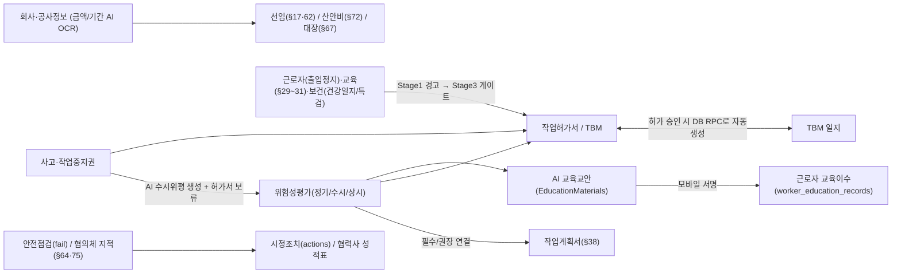

# SafeNex 시스템 고도화·기능 연동·법적 완결성 설계안 (2026-11-13)

> **목적**: 이 문서는 현재 `risk-guard-express`(`main` `d5c3bb46`) 코드 전수 분석을 바탕으로, **① 껍데기/부분 구현 기능 구체화**, **② 회사 정보(공사기간·금액 등) 누락 대응**, **③ 무료 AI 활용 극대화**, **④ 모듈 간 강제 연동을 위한 단계적 성숙 로드맵**, **⑤ 권한·셸 단일화**를 Cursor와 논의·합의하기 위한 설계 PR 문서입니다.  
> **디렉터님 핵심 원칙**:
> 1. *지금은 초기 단계라 코드·기초 데이터가 불안정하므로, 당장 "이거 안 하면 다음 거 안 돼"로 막기보다 **먼저 시스템을 완벽히 갖추고 단계적으로 강제**해야 한다.*
> 2. *노사협의체, 안전보건협의체, 보건, 근로자 교육, 일일 건강일지처럼 껍데기만 있는 기능을 구체화하고, **무료 AI를 최대한 활용해 사용자가 쉽게 쓸 수 있게** 해야 한다.*
> 3. *회사 정보(공사기간·공사금액 등)가 누락된 회사가 많은 현실을 감안한 안전장치와 보완 흐름이 있어야 한다.*

---

## 1. 시스템 진단 요약 (실제 코드 기준)

### 1.1 왜 기능 추가 시 누락·연동 끊김이 반복되는가?
- **권한·셸 4중 분산**: `AppSidebar.tsx`, `ContractorGate.tsx`, `RoleGuard.tsx`, `mobileShell.ts`가 각자 다른 기준으로 회사 유형(`client`, `gc`, `contractor`, `vendor`)과 역할(`master`, `project_admin`, `safety_manager`, `site_manager`, `supervisor`, `viewer`, `worker`)을 판단합니다.
  - 예: 시공사 `site_manager`/`supervisor`는 사이드바 메뉴가 보이지만 누르면 `RoleGuard`에 막혀 홈(`/`)으로 튕깁니다.
  - 예: 협력사 `/vision-fleet`은 사이드바·`ContractorGate`에서 허용되지만 `RoleGuard`가 `isContractorCo`를 무조건 차단합니다.
  - 예: `MobileShell`은 `companyType`을 무시하고 `role`만 보며, `viewer` 역할이 웹(`LOW`)과 모바일(`manager` 버킷: `결재`·`메신저` 노출)에서 정반대로 취급됩니다.
- **결재 후속 처리 이원화**: `Approvals.tsx`에서 카드 승인(`runEntityApproval`)은 작업허가서 승인 후 `ensureTbmAfterPermitIssued`를 호출하지만, 타임라인 탭의 승인 버튼(`handleApprovalAction`)은 이를 호출하지 않습니다.
- **정적/레거시/메모리 전용 버그 잔존**:
  - `OwnerSafetyWorkspace.tsx`: `dashboard` 수치가 하드코딩(`"2건 완료"`, `"67.8%"`, `"28명"`), `TeamPeriodicTasks`·`TeamSharedSheet`는 `localStorage` 전용.
  - `SiteReadinessChecklist.tsx`: 존재하지 않는 레거시 `safety_costs` 테이블 조회로 산안비 항목(`a5`, `c4`)이 항상 실패하고, `>= 0` 조건으로 항상 참인 항목도 존재.
  - `InspectionMode.tsx`: `tbm_participations` 조회에 `project_id` 필터 누락.
  - `MasterData.tsx`: 위험도 매트릭스 저장이 메모리(`cachedConfig`)만 바꿔 새로고침 시 초기화.
  - `VerificationCenter.tsx`: `quality` 탭이 안내 문구 1줄 스텁이고 `excel` 탭의 `handleExcelImport` 버튼이 미연결.

---

## 2. 「단계적 강제 모델」: 먼저 완벽히 채우고, 그다음 게이트로 잠근다

기초 데이터(공사금액·기간, 교육, 건강진단, 협의체)가 아직 비어 있는 현장에서 무작정 Hard Block을 걸면 현장 업무가 마비됩니다. 따라서 모든 연동 게이트는 **3단계 성숙 모델**로 설계합니다.

- **Stage 1 (AI 초안 + 자동 채움 + 비차단 안내)**:
  - 누락 항목이 있어도 상신·배정을 막지 않되, 상단에 **원인 + AI/OCR 원클릭 보완 버튼**을 띄워 사용자가 손쉽게 채우게 합니다.
- **Stage 2 (소프트 게이트: 경고 + 예외 사유 기록)**:
  - 핵심 안전결격(예: 출입정지자, 건강진단 작업제한자, 작업중지 중 허가서)에 대해 **사유 입력 후 예외 승인 또는 즉시 시정**을 선택하게 하고, 감사 로그에 남깁니다.
- **Stage 3 (하드 게이트: 프로젝트 성숙도 충족 시 법적 강제)**:
  - 프로젝트 설정(또는 기본 데이터 완비율 충족 시)으로 **법적 필수 게이트**(예: 기초안전교육 미이수자 투입 차단, 작업중지 해제 전 허가 재개 차단, 고위험 허가서 승인 위평 필수 연결)를 활성화합니다.

---

## 3. 회사 기초 정보(공사기간 · 공사금액) 누락 대응 설계

현재 `company_construction_info`를 참조하는 `safetyScaleHint.ts`, `SafetyAppointments.tsx`, `SafetyCost.tsx`, `LegalDuties.tsx`는 금액·기간이 비어 있으면 안내 문구만 띄우거나 수동 입력에 의존합니다.

### 제안 해결책
1. **미입력 시 시스템 동작 원칙 (차단 금지 + 안전한 기본값)**:
   - 금액·기간이 비어 있다고 선임·산안비·법적업무·발주처 대장 화면을 막지 않습니다.
   - 대신 해당 프로젝트/회사 상단에 **"공사금액·기간 미등록 — 입력 시 안전관리자 선임 기준(§17)·기술지도(§59)·산안비 요율(§72)·안전보건대장(§67)이 자동 계산됩니다"** 배너를 표시합니다.
2. **무료 AI(OCR + 구조화 추출)로 원클릭 입력 (`koreanOcr.ts` + `geminiNative.ts`/`nvidiaChat.ts`)**:
   - 사용자가 **공사계약서, 발주서, 착공신고서(PDF/사진)** 1장을 올리면 AI가 `공사명 · 공사종류(토목/건축) · 도급금액 · 착공일 · 준공일 · 발주처/시공사`를 자동 추출해 `company_construction_info` 초안을 채워줍니다. 사용자는 숫자만 확인하고 저장합니다.
3. **규모 미입력 시 협력사/원도급 기본 법정 의무 분리**:
   - 금액이 없어도 **모든 사업장 공통 의무**(위험성평가 §36, TBM, 작업허가, 기초안전교육 §31, 보호구, 작업중지권 §51)는 100% 동작시키고, 금액 종속 의무(안전관리자 전담, 기술지도, 50억 이상 안전보건조정자 등)만 "금액 입력 후 자동 판정" 상태로 분리합니다.

---

## 4. "껍데기/미구현" 핵심 영역 구체화 + 무료 AI 활용 방안

현재 Edge Functions(`supabase/functions/_shared/`)에는 이미 **Gemini(`gemini.ts`, `geminiNative.ts`), NVIDIA NIM(`nvidiaChat.ts`), DeepSeek(`deepseekRisk.ts`), 한국어 OCR(`koreanOcr.ts`), AI 라우터(`aiRoute.ts`), 응답 캐시(`aiResponseCache.ts`)** 가 구축되어 있습니다. 이 무료/저비용 AI 자산을 껍데기 모듈에 직접 연결합니다.

### 4.1 근로자 교육 (`WorkerEducation.tsx` + `EducationMaterials.tsx` + `LegalEducationMapping.tsx`)
- **현재 문제**: `EducationMaterials.tsx`에는 AI 교안 생성(`generate-education-material`)이 있지만, 정작 `WorkerEducation.tsx`는 `hours: 0`도 저장되는 단순 CRUD 표에 그쳐 교안·서명·법정시간 검증이 끊겨 있습니다.
- **구체화 & AI 활용**:
  1. **이수증 OCR 자동 등록**: 근로자나 관리자가 **건설업 기초안전보건교육 이수증(§31)** 또는 외부 교육 수료증 사진을 찍어 올리면 AI OCR(`koreanOcr`)이 `교육기관·이수일·이수번호·교육시간`을 자동 입력.
  2. **AI 교안 → 모바일/QR 교육 → 이수대장 자동 적재**: `EducationMaterials`로 만든 AI 교안(다국어 번역 `translate-doc-view` 포함)을 현장 공지/TBM에 배포하고 근로자가 모바일에서 열람·서명하면 `worker_education_records`가 **자동 생성**되도록 연결.
  3. **법정 최소시간 & 갱신 주기 가이드(산안법 §29, 별표4)**: 교육유형별 법정 기준 시간(예: 일용직 채용시 1시간, 상용직 8시간, 특별교육 16시간/단기 2시간, 관리감독자 연 16시간)을 기본값으로 채워주고 미달 시 경고 표시.

### 4.2 근로자 일일 건강일지 (`MobileDailyHealthLog.tsx`) & 보건 6종 (`src/pages/health/*`)
- **현재 문제**:
  - `MobileDailyHealthLog`: `!fitToWork`나 고열(≥37.5°C)이 나와도 관리자에게 알림 1건 보낼 뿐, **후속 조치·작업배치 제한·정상복귀 해제 기록**이 없습니다.
  - `health/*`: `HealthDashboard`의 보건교육 카드가 `"-"` 하드코딩이고, 5개 서브메뉴(`HealthCheckups`, `EnvMeasurements`, `Chemicals`, `HealthEducation`, `HazardSurveys`) 모두 **등록만 되고 수정 UI가 없습니다**.
- **구체화 & AI 활용**:
  1. **건강일지 이상소견 조치 루프**: 이상소견 발생 시 `safety-assistant` AI가 증상/혈압/체온 기준 **현장 관리감독자 행동 요령(휴식·고소/밀폐작업 배제·병원 이송 등)** 을 즉시 제안하고, 관리자가 `[조치 완료(작업전환/귀가/정상복귀)]`를 기록해야 당일 건이 종결되도록 개선.
  2. **건강진단 결과표 · 작업환경측정표 · MSDS AI 파싱**:
     - `HealthCheckups`: 검진 결과표 PDF/이미지 업로드 시 AI가 **유소견(D1/D2)·배치제한 소견(`restrictions`)** 을 자동 추출.
     - `EnvMeasurements`: 측정 결과표 업로드 시 **노출기준 초과 유해인자**를 자동 추출해 `safety_inspection_actions` 시정조치 트래커로 자동 연결.
     - `Chemicals`: MSDS PDF 업로드 시 AI가 **그림문자·유해위험문구·필수 보호구·응급조치**를 자동 요약하고, 해당 물질 취급 근로자에게 **MSDS 교육(`HealthEducation`)** 을 자동 배정.
  3. **`health/*` 전 화면 수정/삭제 CRUD 완비** 및 `HealthDashboard` 실DB 집계 전환.

### 4.3 도급인·발주처·노사 핵심 의무 구체화 (현재 `LegalDuties` 텍스트 1줄 또는 누락)
1. **안전보건협의체(산안법 §64①1, 월 1회) · 도급인-수급인 합동점검(§64①3, 분기 1회) · 산업안전보건위원회/노사협의체(§24·§75)**:
   - 전용 회의/점검 기록 모듈 신설(참석자: 도급인 + 협력사 대표/안전관리자 + 근로자위원 서명).
   - **AI 안건·회의록 자동 생성**: 직전 1개월간 시스템에 쌓인 **위험성평가 핵심항목, 안전점검 부적합, 아차사고/작업중지, 근로자 의견**을 AI가 취합해 회의 안건과 회의록 초안을 1클릭 생성.
   - 회의에서 나온 지적사항은 `safety_inspection_actions`로 바로 발행해 이행 추적.
2. **발주처(`client`) 안전보건대장(산안법 §67) & `OwnerSafetyWorkspace` 실DB화**:
   - 기본·설계·공사안전보건대장 단계별 체크리스트·파일·이행확인 워크플로우 추가 (AI가 프로젝트 공종·위험성평가 기반 공사안전보건대장 이행점검 요약 초안 지원).
   - `OwnerSafetyWorkspace`의 정적 대시보드와 `localStorage` 2개 탭(`TeamPeriodicTasks`, `TeamSharedSheet`)을 DB로 전환.
3. **중대재해처벌법 적격수급인 사전평가 & 반기 점검**:
   - `ContractorScorecard`는 사후 감점만 있으므로, `Companies` 협력사 투입 단계에 **적격수급인 선정평가표**(AI가 제출 서류 요약/채점 보조)를 연결.

### 4.4 사고(`Incidents`) · 작업중지권(`WorkStopRequests`)의 사후 AI 자동화
- **사고 발생 → 수시 위험성평가 & 산업재해조사표(별지 제30호) AI 초안**:
  - `Incidents` 등록 시(특히 `is_major` 또는 휴업 3일 이상) `generate-accident-ai`가 사고 개요로부터 **수시 `assessment_runs` 항목 초안**과 **산업재해조사표 입력 초안**을 자동 생성하고, `approvals` (`'incident'` 타입 실연동) 결재로 연결.
- **작업중지권 → 허가서 연동 & 재개 검증**:
  - 접수 시 연관 `work_permits`에 보류 배너/일시중지 상태를 연동하고, 해제(`조치완료`) 시 전/후 사진·관리자 점검·근로자 확인 체크리스트를 통과해야 `resumed_at`을 기록.

---

## 5. 전체 기능 간 연동 지도 (목표 아키텍처)

### 즉시 고쳐야 할 연동·권한 5가지 (Phase 1)
1. **단일 권한·셸 매트릭스**: `AppSidebar`, `RoleGuard`, `ContractorGate`, `MobileShell`, `MobileMore`가 하나의 `resolveAccessCapabilities(roles, companyType, position)`를 공유하도록 통합 (`site_manager`/`supervisor` 튕김, `/vision-fleet`·`/announcements` 모순, `viewer` 혼선, 모바일 `companyType` 무시 해소).
2. **전자결재 후속 처리 DB 단일화**: `Approvals.tsx`의 타임라인 버튼(`handleApprovalAction`)과 카드 승인(`runEntityApproval`) 간 `ensureTbmAfterPermitIssued` 누락을 DB RPC(`act_on_entity_approval`) 내부로 일원화.
3. **기존 화면 버그 수정**: `SiteReadinessChecklist`의 `safety_costs`→`safety_cost_items` 교체 및 `>= 0` 오류 수정, `InspectionMode` `tbm_participations` 프로젝트 필터 추가, `MasterData` 위험도 매트릭스 DB 저장.
4. **모바일/PC 누락 방지**: 신규 기능 추가 시 `PC 관리자 + 모바일 + 회사유형별 노출`을 한 세트로 검증하는 테스트 체크리스트 도입.
5. **보건/발주처 껍데기 해소 1차**: `OwnerSafetyWorkspace` DB화 + `health/*` 전 화면 수정/삭제 CRUD 추가.

---

## 6. Cursor에게 묻는 핵심 합의 질문 (PR 논의용)

1. **단계적 강제(Stage 1 → 2 → 3) 전환 기준**:
   - 지금 당장 Hard Block 대신 `경고 + AI 원클릭 보완`으로 시작해, 어떤 조건(예: 프로젝트별 "엄격 게이트" 토글 vs 기능별 완비 체크 후 일괄 전환)으로 강제 게이트를 켜는 게 안전할까요?
2. **`company_construction_info`(공사기간·금액) 누락 대응**:
   - 계약서/발주서 PDF·이미지 업로드 시 기존 `koreanOcr` + `geminiNative`로 공사금액·기간을 자동 추출하는 흐름을 `Companies` / `ProjectDetail` 중 어디에 두는 게 맞을까요?
3. **껍데기 기능 구체화 우선순위**:
   - ① 근로자 교육(이수증 OCR + AI 교안 서명→이수대장 자동 적재), ② 건강일지 조치루프 + `health/*` CRUD/AI 파싱, ③ 도급인 협의체/합동점검/노사협의체(§64·§75) + AI 안건 생성, ④ 발주처 안전보건대장(§67) 중 어떤 순서로 쪼개서 구현할까요?
4. **결재 후속 연동 DB 단일화**:
   - `Approvals.tsx`에서 클라이언트가 호출하던 `ensureTbmAfterPermitIssued`나 `assessment_runs` 상태 보정을 DB RPC(`act_on_entity_approval`) 또는 트리거로 내리는 것에 동의하시나요?
5. **무료 AI 활용 표준화**:
   - 기존 `_shared/geminiNative.ts`, `nvidiaChat.ts`, `koreanOcr.ts`를 활용해 교육·보건·협의체·계약서 OCR을 붙일 때, 쿼터 소진/실패 시 사용자 화면이 멈추지 않도록 하는 공통 폴백 규칙을 어떻게 통일할까요?

---

## 다른 AI의 의견

<!-- Cursor 또는 다른 AI는 아래에 날짜·작성자·의견을 이어서 작성해 주세요. -->
