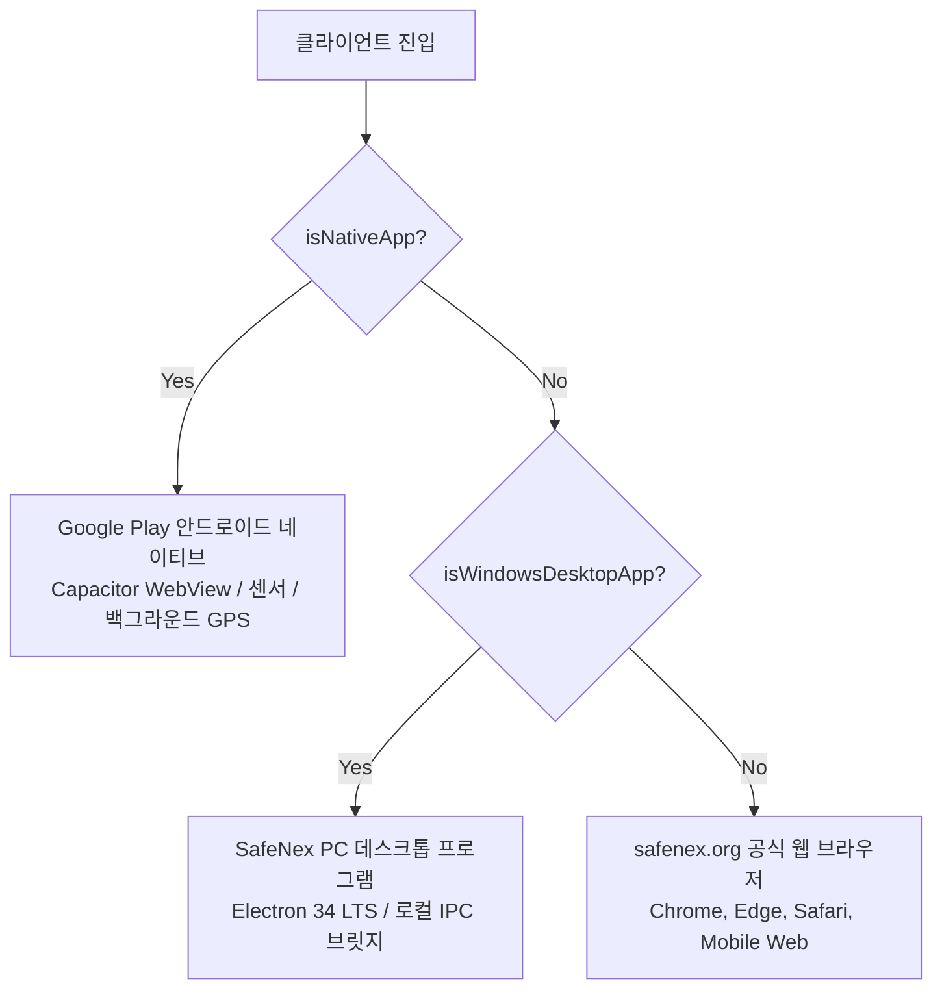

# SafeNex 멀티플랫폼(안드로이드 구글 플레이 · PC 데스크톱 · 공식 웹) 통합 운영 규칙 (SSOT)

> **핵심 원칙**: SafeNex 시스템은 **Google Play에 정식 출시된 안드로이드 네이티브 앱**, **Windows PC 메신저 및 그룹웨어 프로그램**, **공식 웹사이트(`safenex.org`)** 가 동일한 백엔드(Supabase)와 웹 코드베이스를 공유합니다. 
> 하나의 플랫폼 수정이나 배포 작업이 다른 플랫폼에 절대로 부작용이나 오작동을 유발하지 않도록 아래 규칙을 엄격히 준수합니다. (관련 이슈: **#625**)

---

## 1. 플랫폼 판별 및 런타임 격리 원칙



### 규칙 1-1. 플랫폼 가드 필수화
| 플랫폼 | 식별 함수 | 허용 리소스 | 금지 리소스 |
|---|---|---|---|
| **안드로이드 네이티브** | `isNativeApp()` (`Capacitor.isNativePlatform()`) | `@capacitor/*`, `@capgo/*`, 하드웨어 GPS, 백그라운드 위치, FCM 푸시, 바코드 카메라 스캐너 | PC 전용 브릿지(`window.safenexDesktop`), Win32 레지스트리/쉘 제어 |
| **PC 데스크톱** | `isWindowsDesktopApp()` (`safenexDesktop.isDesktopApp`) | Electron 독립 런타임, 로컬 IPC 브릿지(`safenexDesktop.*`), 창 크기 자동 조절, 트레이 상주, 작업표시줄 뱃지 | Capacitor 네이티브 전용 플러그인 (가드 없이 호출 금지), 모바일 전용 바텀 네비게이션 |
| **공식 웹 (`safenex.org`)** | 둘 다 `false` | 표준 브라우저 API, PWA 설치 프롬프트 | 네이티브 전용 플러그인 직접 호출, 데스크톱 네이티브 쉘 전제 기능 |

---

## 2. 폰 OTA와 PC OTA 목록

같은 시각의 `main` 푸시는 `android` 행과 `desktop` 행을 같이 만든다. zip과 버전 문자열은 같다. 채널 이름은 그대로 `stable` 또는 `beta`다.

- 폰 조회는 `android`, PC 조회는 `desktop`이다. 인자를 생략하는 예전 클라이언트는 `android`와 `shared`만 본다.
- 버전 비교는 `src/lib/otaVersion.ts` 하나다. 더 낮은 번호는 시각이 있어도 더 높은 설치본을 갱신하지 않는다.
- 폰의 조용한 다음 실행 적용은 유지한다. PC가 바로 새로고침하는 것은 desktop 행이 필수일 때만이다.
- 결재, 허가서, 위험성평가, TBM 작성 함수와 테이블은 이 목록과 무관하다.

---

## 3. 버전 관리 및 SSOT 원칙 (Versioning Rules)

### 규칙 3-1. `package.json`이 유일한 단일 진실 공급원 (SSOT)
- 모든 시맨틱 버전(SemVer, 예: `1.1.5`)의 기준은 `package.json`의 `"version"` 필드입니다.
- **절대 금지**: `package.json`을 올리지 않고 개별 UI 화면이나 런처의 버전 문자열만 단독으로 올리는 행위 금지.
- 버전을 올릴 때는 `package.json`을 먼저 수정하고, 관련된 런처/다이얼로그의 기본값을 함께 동기화해야 합니다.

### 규칙 3-2. OTA 릴리스 명명 규칙
- 버전 문자열은 `<package.json.version>-<YYYYMMDDHHMM>`이다. 플랫폼 접두사를 붙이지 않는다.
- 플랫폼은 버전 문자열이 아니라 `app_releases.platform`으로 구분한다.

---

## 4. 구글 플레이 스토어 안전 보장 규칙 (Google Play Store Safety)

### 규칙 4-1. `min_native_version` (Play 스토어 강제 업데이트 기준) 보존
- `min_native_version`은 `android` 행에만 둔다. `desktop` 행은 비운다. 값은 **Google Play에 업로드된 안드로이드 바이너리의 `versionCode` 정수**(예: `478`)이다.
- AAB 게시는 `android` 행만 고친다. PC 게시와 PC 핫스왑은 이 값을 읽거나 쓰지 않는다.
- **치명적 위험 방지**:
  - PC 업데이트나 웹 배포 시 이 값을 `null`로 지우거나, 임의의 문자열(예: `1.1.5`)로 덮어쓰면 **구글 플레이 정상 사용자들에게 스토어 업데이트 차단 화면(NativeStoreUpdateGate)이 오작동하거나 구버전 차단이 해제**됩니다.
  - `publish-ota-release` Edge Function은 신규 OTA 업로드 시 직전 릴리스의 `min_native_version`을 자동으로 유지·계승합니다.
  - 네이티브 코드가 변경되어 Play 스토어 새 AAB 배포가 필요한 경우에만 관리자 메뉴(`/app/admin/settings/mobile-releases`) 또는 AAB CI를 통해 새 `versionCode`로 명시적 갱신합니다.

### 규칙 4-2. 안드로이드 AAB 빌드와 웹/PC 빌드의 독립성
| 구분 | 트리거 | 빌드 산출물 | 배포 대상 |
|---|---|---|---|
| **웹 (safenex.org)** | `main` 브랜치 push | Web 번들 (`dist/`) | Vercel 호스팅, PC 실시간 클라우드 뷰 |
| **안드로이드 OTA** | 모바일 릴리즈 승인 시 | Capgo 호환 zip | Supabase Storage (`app-updates`), Google Play 출시 앱 무설치 업데이트 |
| **안드로이드 구글 플레이** | `android-v*` 태그 push 또는 수동 워크플로 실행 | 서명된 `.aab` + R8 `mapping.txt` + NDK 심볼 | Google Play Console (내부 테스트 / 프로덕션 트랙) |
| **PC 데스크톱 독립 셸** | 데스크톱 릴리즈 배포 시 | `SafeNex_PC_Setup_<version>.exe` | Windows PC 사용자 |

---

## 5. PC 데스크톱 및 웹사이트 연동 규칙 (Desktop Architecture)

### 규칙 5-1. Electron 독립 런타임 규격 (옵션 B 반영)
- 레거시 Microsoft Edge 브라우저 종속 및 C# 런처(`127.0.0.1:45780`)는 **완전 폐기**되었습니다.
- PC 프로그램은 자체 내장 Chromium 및 Node.js 런타임을 포함한 **Electron 34 LTS 단독 실행 패키지**를 사용합니다.
- 설치 경로는 `%LOCALAPPDATA%\Programs\SafeNex PC\`이며, 안드로이드의 `Capacitor Preferences` 스토리지와 완전히 격리됩니다.
- 창 배경색은 `#1e2229` 다크 테마로 통일하여 상단 화이트 여백 번쩍임을 차단합니다.
- 모니터 작업 영역(`workArea`)을 감지하여 150% 노트북 배율에서도 창이 작업표시줄 밑으로 잘리지 않는 스마트 리사이즈(`resizeWindowSmart`)를 사용합니다.

### 규칙 5-2. 원클릭 웹사이트 브라우저 열기 (`desktopBridge.openSafeNexWebSite`)
- PC 프로그램의 '웹 사이트 바로가기' 클릭 시 운영체제 네이티브 쉘(`shell.openExternal`)을 통해 사용자의 기본 브라우저(Edge, Chrome 등) 전체 화면으로 즉시 `https://safenex.org/app/admin`을 엽니다.

---

## 6. [AI 상호 협약 대화] AI-2(PC/데스크톱 담당) ➔ AI-1(모바일/백엔드 담당) 상호 요청 및 합의서 (Issue #625)

> 이 섹션은 **모바일/백엔드를 담당하는 AI-1**과 **PC 데스크톱/웹을 담당하는 AI-2(Antigravity)** 가 서로 충돌 없이 협력하기 위해 작성된 **상호 요청 및 역할 분담 합의서**입니다. 다음 작업 시 상대방 AI는 아래 요청 사항을 반드시 준수하여 작업해야 합니다.

### 🤝 [AI-2 ➔ AI-1] 모바일/백엔드 담당 AI에게 요청합니다 (AI-1이 해줄 일)

1. **`app_releases` 조회 시 플랫폼 격리 필터를 적용해 줘**:
   - 모바일 Capgo OTA 업데이트를 담당하는 `otaUpdater.ts`에서 `get_latest_app_release`를 호출할 때 `_channel`은 기존 `stable` 또는 `beta`로 두고 `_platform: 'android'`만 넘긴다. 채널 이름을 `android-production`으로 바꾸지 않는다.
   - PC 전용 릴리스가 등록되더라도 모바일 폰이 그걸 잘못 내려받아 스마트폰이 먹통(화이트스크린)이 되지 않도록, 모바일은 오직 **안드로이드 전용 레코드만 조회**하도록 철저히 가드해 줘.

2. **Capgo OTA 번들 패키징 시 PC 전용 리소스 제외해 줘**:
   - 모바일용 OTA ZIP을 생성할 때, `electron/` 폴더 전체와 PC 전용 파일들이 모바일 번들에 섞여 들어가지 않도록 번들 빌드 설정을 지켜줘. 모바일 앱 용량을 줄이고 충돌을 예방할 수 있어.

3. **`min_native_version` (Play 스토어 versionCode: 478) 관리**:
   - `min_native_version`은 구글 플레이스토어에 출시된 안드로이드 AAB의 생명줄이야. 실제 플레이스토어 새 바이너리(AAB)를 심사 제출할 때를 제외하고는 이 값을 함부로 올리거나 `null`로 초기화하지 말아 줘.

---

### 🛡️ [AI-2의 확약] PC 데스크톱 담당 AI가 책임지고 보장하는 사항 (AI-2가 하는 일)

1. **C# 포트 45780 및 Edge 브라우저 의존성 완전 폐기 완료**:
   - 사용자가 불편해하셨던 엣지 바로가기 생성, 상단 여백 번쩍임, 배율 왜곡을 없애기 위해 **Electron 34 LTS 단독 런타임**으로 완전히 교체했어.
   - 레거시 C# 로컬 서버(`127.0.0.1:45780`)는 이제 쓰지 않으며, 안전한 운영체제 내부 IPC(`safenexDesktop`)로만 동작해.

2. **모바일 전용 Capgo 저장소 버킷을 건드리지 않을게**:
   - PC는 `desktop` 행의 zip만 보고, 그 적용은 창이 열린 로컬 포트의 `/__desktop/apply-ota`로 한다. 폰 행의 `mandatory`나 `min_native_version`은 읽지 않는다.

3. **모바일 네이티브 센서/GPS 코드 100% 무결성 보존**:
   - 백그라운드 GPS 추적(`headlessTrack`), 비상 알람(`alarmVolume`), FCM 푸시 등 안드로이드 고유 코드는 PC용 코드 변경 시 단 1글자도 건드리지 않고 철저히 보호할게.

---

### ⚖️ 공통 합의 규약 (상호 준수)
* **SSOT 버전 동기화**: `package.json`의 `"version"`을 기준으로만 버전을 올리고, 개별 파일에 임의의 하드코딩 버전을 생성하지 않는다.
* **타사 명칭 배제**: UI 및 코드 설명에 타사(카카오톡, 네이버웍스 등) 브랜드를 쓰지 않고 SafeNex 공식 명칭("PC 메신저 모드", "상시 알림 환경")으로 통일한다.

---

## 7. 배포 전 필수 검증 체크리스트

모든 변경 사항은 아래 4대 단위 테스트를 통과해야 커밋 및 배포할 수 있습니다:

1. **PC 데스크톱 브릿지 및 설정 테스트**:
   ```bash
   bun run test src/test/desktopWorkspace.test.ts
   ```
2. **안드로이드 OTA 버전 비교 로직 테스트**:
   ```bash
   bun run test src/test/otaVersionCompare.test.ts
   ```
3. **Play 스토어 `min_native_version` 보존 테스트**:
   ```bash
   bun run test src/test/otaMinNativePublish.test.ts
   ```
4. **구글 플레이 네이티브 스토어 업데이트 게이트 테스트**:
   ```bash
   bun run test src/test/nativeStoreUpdate.test.ts
   ```

---

## 8. PC 프로그램 무설치(Zero-Reinstall) 자동 업데이트 및 전문 메신저 운영 규약 (AI 간 상호 준수)

1. **구형 C# 파일(`electron/SafeNexWindowsSetup.cs`) 영구 폐기 및 컴파일 절대 금지**:
   - `SafeNexWindowsSetup.cs`는 레거시 Edge WebView 방식의 구형 파일이며, 현재 **영구 폐기(DEPRECATED)**되었습니다.
   - 어떤 AI 에이전트나 자동화 스크립트도 본 파일을 `csc.exe` 등으로 컴파일하여 사용자에게 새로운 `.exe` 파일로 전달해서는 안 됩니다.
   - SafeNex PC의 유일한 정식 런처는 **Electron 34 LTS (`electron/main.cjs`)**입니다.

2. **무설치 백그라운드 핫스왑(Zero-Reinstall OTA) 절대 준수**:
   - 화면, UI, 기능, 결재, 메신저 수정 사항은 GitHub Actions의 `mobile-release.yml` (`X-OTA-Platform: both`)을 통해 배포됩니다.
   - PC 클라이언트는 `/__desktop/apply-ota`를 통해 백그라운드에서 zip 번들을 무설치로 자동 교체합니다.
   - **사용자에게 "설치 프로그램을 다시 실행하라"거나 수동 재설치를 요구하는 것은 엄격히 금지**됩니다.

3. **전문 산업안전 엔터프라이즈 메신저 발전 로드맵 준수**:
   - 상세 로드맵은 `docs/desktop-autoupdate-and-messenger-roadmap.md`를 단일 진실 공급원(SSOT)으로 삼습니다.
   - 메신저 내 결재 카드(In-Chat Actions), 조직도 채널링, 상세 읽음 확인/넛지, 비상 경보 배너의 구조를 상호 유지합니다.
